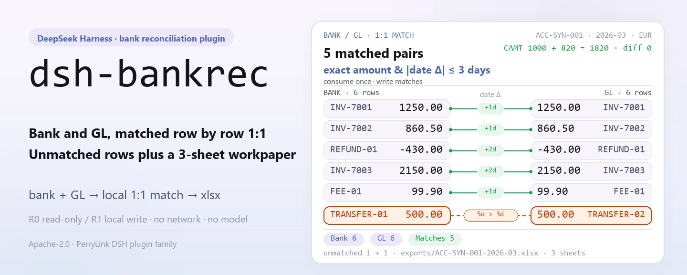
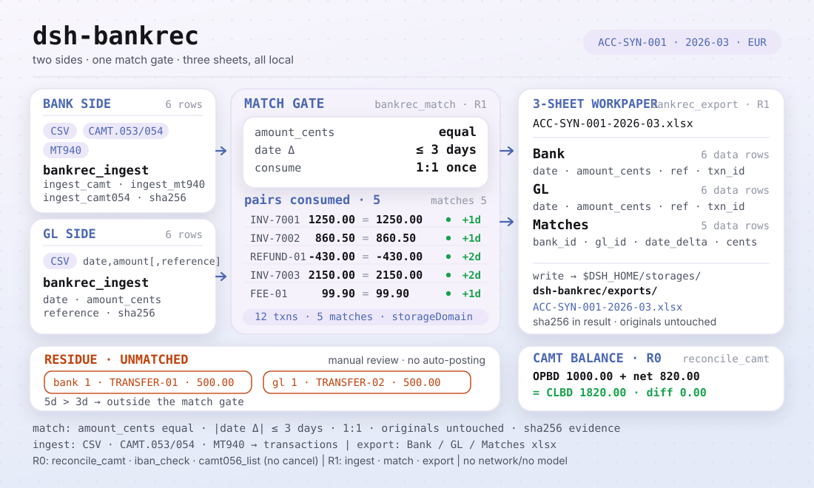
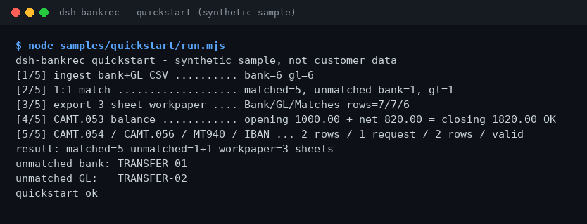

<div align="center">

<picture>
  <source media="(prefers-color-scheme: dark)" srcset="docs/assets/dsh-bankrec-hero-en-dark.webp">
  
</picture>

# dsh-bankrec

**Reconcile bank statements against the GL row by row — unmatched rows plus a 3-sheet workpaper, entirely on your own machine.**

A bank-reconciliation plugin for DeepSeek Harness: ingest CSV, CAMT.053/054/056 and MT940, match 1:1, verify CAMT balances, and export a `Bank` / `GL` / `Matches` xlsx.

[Install](#three-step-setup) · [Configuration](#configuration) · [FAQ](#faq) · [简体中文](README.md) · [English](README.en.md) · [Español](README.es.md) · [Português](README.pt.md) · [हिन्दी](README.hi.md)

[](LICENSE)
[](#compatibility)
[](https://www.npmjs.com/package/dsh-bankrec)
[](https://github.com/PerryLink/dsh-bankrec/actions/workflows/ci.yml)
[](#compatibility)

[](https://github.com/PerryLink/dsh-bankrec/stargazers)
[](https://www.npmjs.com/package/dsh-bankrec)
[](https://dshfind.com/plugins/PerryLink/dsh-bankrec?ref=badge)
[](https://dsh.market/)
[](https://gitee.com/perrylink/dsh-bankrec)

```sh
dsh plugin --profile <profile> add dsh-bankrec
```

</div>

<sub>Community plugin, not affiliated with DeepSeek. Canonical repository: <https://github.com/PerryLink/dsh-bankrec> (Gitee is a mirror).</sub>

> **Status: alpha / public-synthetic / partial / not counted / not GA.** No customer evidence, customer data, or production-readiness claim.

## What it is

`dsh-bankrec` ingests bank statements (CSV, CAMT.053/054/056, MT940) and GL CSV into a local storage domain, matches rows 1:1 by exact amount and date within ±3 days, verifies CAMT opening + entries = closing, and exports a 3-sheet xlsx workpaper (`Bank` / `GL` / `Matches`). Everything runs on your machine: no network, no model calls, no uploads — and original files are never modified. All nine tools are namespaced `bankrec.*`; file-writing operations are labeled R1 (local write), read-only ones R0.

- **Good fit**: tens to hundreds of bank-statement and GL CSV rows, or CAMT.053 / CAMT.054 / CAMT.056 and MT940 statements — when you need a 3-sheet workpaper a colleague can review.
- **Not a fit**: automatic posting adjustments or write-backs to a bank or ERP; this package only checks locally and never makes the approval decision for you.

<picture>
  <source media="(prefers-color-scheme: dark)" srcset="docs/assets/dsh-bankrec-flow-v5-dark.svg">
  
</picture>

## Three-step setup

1. **Install** (pick one channel):

   ```sh
   # npm channel (recommended; published releases)
   dsh plugin --profile <profile> add dsh-bankrec
   # git channel (latest main; equivalent to git+https://github.com/PerryLink/dsh-bankrec.git)
   dsh plugin --profile <profile> add github:PerryLink/dsh-bankrec
   # tarball channel: pnpm pack in this repo, then
   dsh plugin --profile <profile> add ./dsh-bankrec-<version>.tgz
   ```

2. **Minimal config**: there are no config keys — `cordis.patch.yml` only `insert`s one row, and the defaults are all you need; the only tunable is the `DSH_BANKREC_HOME` environment variable (see "Configuration").

3. **Verify it works**:

   ```sh
   dsh --profile <profile> --dump-config | grep dsh-bankrec
   node samples/quickstart/run.mjs
   ```

   The quickstart runs ingest → match → export on the bundled synthetic sample and compares against the golden `samples/quickstart/expected/result.json`.

**Uninstall**: `dsh plugin --profile <profile> remove dsh-bankrec` (or remove the row from the profile patch).

<details>
<summary>Install from the DSH Desktop market</summary>

Every PerryLink plugin is listed in the built-in DSH Desktop market: **Market → Sources → Add source → paste** `https://perrylink-dsh-catalog.perrylink.workers.dev/catalog-source.json` **→ select**. Installation still requires the market's npm identity check and your confirmation.

</details>

## Core capabilities

- **Multi-format ingest** — bank/GL CSV, CAMT.053, CAMT.054, MT940; IBAN validated per ISO 13616. Ingest returns sha256 evidence hashes; amounts are kept as integer cents.
- **1:1 matching** — `bankrec.match` consumes pairs by exact amount and date within ±3 days, stores the matches, and returns both unmatched sides.
- **CAMT balance check** — `bankrec.reconcile_camt` verifies opening + entries = closing; `account_id` is required when the statement is ambiguous.
- **3-sheet workpaper** — `bankrec.export` writes an xlsx with `Bank` / `GL` / `Matches` sheets under `exports/`.
- **Read-only cancellations** — `bankrec.camt056_list` lists CAMT.056 cancellation requests; nothing is ever cancelled.
- **Fully local** — no HTTP / DNS / WebSocket calls in the source; it connects to no bank, ERP, or cloud service.

### Tool surface

Tool names are the stable API (kept in English to match the runtime output).

| Tool | Purpose | Risk |
|---|---|---|
| `bankrec.ingest` | Ingest bank/GL CSV rows (`date,amount[,reference]`, per account+period); integer cents, evidence hashes | R1 local write |
| `bankrec.ingest_camt` | Ingest CAMT.053 XML statement entries (DBIT/CRDT supported) | R1 local write |
| `bankrec.ingest_camt054` | Ingest CAMT.054 debit/credit notifications (BkToCstmrDbtCdtNtfctn) as bank rows | R1 local write |
| `bankrec.ingest_mt940` | Ingest MT940 statement entries | R1 local write |
| `bankrec.match` | 1:1 match bank rows to GL rows by exact amount and date within ±3 days; stores matches, returns unmatched | R1 local write |
| `bankrec.reconcile_camt` | Check CAMT opening + entries = closing; requires `account_id` when ambiguous | R0 |
| `bankrec.export` | Export a 3-sheet xlsx: Bank / GL / Matches | R1 local write |
| `bankrec.iban_check` | Validate an IBAN per ISO 13616 (charset, length, country BBAN length, mod-97) | R0 |
| `bankrec.camt056_list` | List CAMT.056 cancellation requests (original tx id, end-to-end id, reason code, account); read-only, nothing is cancelled | R0 |

### Input & output

Input:

- Bank-statement CSV and GL CSV: UTF-8, header row with at least `date,amount`, optional `reference`; dates `YYYY-MM-DD`; amounts with at most two decimals, outflows negative.
- CAMT.053 / CAMT.054 / CAMT.056 XML (ISO 20022), or MT940 text (with `:25:` and `:61:`).
- IBAN strings (ISO 13616) for validation.
- No hard size limit on the tools; keep each file ≤5 MB. The bundled sample lives in `samples/quickstart/input/` (synthetic, well under 500 KB).

Output:

- Terminal summary: how many matched, and how many bank/GL rows stayed unmatched.
- 3-sheet workpaper: `$DSH_HOME/storages/dsh-bankrec/exports/<account>-<period>.xlsx` with sheets `Bank` / `GL` / `Matches`.
- Original files are never modified.

### Examples

Copy this prompt verbatim (the demo prompt from `package.json`):

```text
帮我用自带样例跑一次银行流水对账，告诉我匹配了几笔、还有哪几笔没对上，并导出三张表的底稿。
```

Or run it yourself (a real run; the screenshot comes from this command):

```sh
node samples/quickstart/run.mjs
```



*Synthetic sample → golden `samples/quickstart/expected/result.json`; command and hashes in `screenshots.json`.*

Fixture-backed example: input [`fixtures/public/mit-camt/example-camt053-a.xml`](https://github.com/PerryLink/dsh-bankrec/blob/main/fixtures/public/mit-camt/example-camt053-a.xml) (public MIT sample); command `pnpm test`.

Acceptance: `node scripts/acceptance.mjs`, details in `ACCEPTANCE.csv` (all 11 rows pass; SKU rows are `counted=false`, PS1-QS01 is the bundled-sample replay `counted=true`):

```csv
req_id,metric,threshold,actual,pass,source,counted
SKU-06-A01,流水解析（30）,30/30,30,true,public/synthetic,false
SKU-06-A02,1:1 匹配,30/30,30,true,public/synthetic,false
SKU-06-A03,未达行,0,0,true,public/synthetic,false
SKU-06-A04,底稿 sheet,3,3,true,public/synthetic,false
SKU-06-A05,CAMT.053 公开样本行,11,11,true,public/synthetic,false
SKU-06-A06,CAMT 余额恒等式,1/1,1,true,public/synthetic,false
SKU-06-A07,MT940 公开样本行,5,5,true,public/synthetic,false
SKU-06-A08,IBAN ISO 13616 mod-97,1/1,1,true,public/synthetic,false
SKU-06-A09,CAMT.054 通知行,2,2,true,public/synthetic,false
SKU-06-A10,CAMT.056 取消请求,1,1,true,public/synthetic,false
PS1-QS01,quickstart 样例与金标一致,1/1,1,true,synthetic/quickstart,true
```

*These are fixture/sample-backed acceptance rows, not customer runs; the full columns (incl. `script` and `evidence_sha256`) are in [`ACCEPTANCE.csv`](ACCEPTANCE.csv).*

## Configuration

This plugin has no Schemastery config keys: `cordis.patch.yml` only `insert`s one row (`id: dsh-bankrec`), and the defaults are all you need.

| Key | Default | Meaning |
|---|---|---|
| `DSH_BANKREC_HOME` (environment variable) | `$DSH_HOME/storages/dsh-bankrec` | Root directory for the reconciliation index (transactions / matches tables) and `exports/*.xlsx`; falls back to `storages/dsh-bankrec` under the host process cwd when `DSH_HOME` is unset |

## FAQ

<details>
<summary>Install fails — what now?</summary>

Check that DSH is `>=0.2.1-rc.3 <0.4.0` and Node `>=24.9 <25`, then retry with a fresh `DSH_HOME`; the full steps are in [`TROUBLESHOOTING.md`](TROUBLESHOOTING.md).

</details>

<details>
<summary>The amounts are identical — why didn't they match?</summary>

Matching consumes pairs 1:1 by "exactly equal amount + dates within ±3 days"; one cent off or more than 3 days apart lands in the unmatched rows — review them by the unmatched references in the summary.

</details>

<details>
<summary>Can it process my real bank statements?</summary>

It runs locally, but the package is alpha and validated on public/synthetic data only — it is not an audit conclusion; redact real data first and keep a human reviewer in the loop.

</details>

<details>
<summary>Where does the data live? Is anything uploaded?</summary>

Only `$DSH_HOME/storages/dsh-bankrec` (or the directory `DSH_BANKREC_HOME` points to) is written: the reconciliation index and the exported xlsx. No network, no uploads; original files are never modified.

</details>

## Security boundaries

- **Read scope**: only the bank/GL CSV, CAMT XML, MT940 text, and IBAN values passed in through the session; no other directories are read.
- **Write scope**: only the `dsh-bankrec` storage domain (reconciliation index) and `exports/*.xlsx`; export paths go through a `safe-path` check against directory escape; original files are never modified.
- **No network**: the source contains no HTTP / DNS / WebSocket calls; it connects to no bank, ERP, or cloud service, and uploads nothing.
- **Evidence hashes**: both ingest and export return sha256 values for the review trail.
- **Risk labels**: file-writing tools are labeled R1 (local write), read-only tools R0; see the per-tool table under "Core capabilities".

## Known limitations

- **Public/synthetic validation only**: alpha / partial / not counted / not GA; no customer data or customer evidence, and no production-readiness claim.
- **Rigid matching rule**: amounts must match exactly (integer cents) and dates be within ±3 days; one cent or one day too many lands in the unmatched rows and needs human review.
- **Input format constraints**: CSV is UTF-8 with a header row of at least `date,amount` (optional `reference`); dates are `YYYY-MM-DD`; amounts carry at most two decimals, outflows negative. The tools set no hard size limit; keep each file ≤5 MB.
- **No auto-adjustment**: local checking only — nothing is written back to a bank or ERP, and no approval decision is made for you; CAMT.056 cancellation requests are listed, never executed.
- **Exact boundaries**: the per-tool boundaries are the tool table above and `ACCEPTANCE.csv`.

## Compatibility

| Surface | Status |
|---|---|
| Harness | `dsh >=0.2.1-rc.3 <0.4.0` |
| Node | `>=24.9.0 <25` |
| Platforms | Anywhere DSH runs; local files only |
| Data | No network, no model call, no upload |

## Ecosystem & quality

- [Gitee mirror](https://gitee.com/perrylink/dsh-bankrec) (sync mirror; GitHub is canonical)
- [dshfind plugin page](https://dshfind.com/plugins/PerryLink/dsh-bankrec) (installs and ranking)
- [DSH Market](https://dsh.market/) (listed)
- **1024 store channel**: `npm i -g dsh1024` once, then `dsh1024 plugin --profile <profile> add dsh-bankrec` (counts toward the [deepseek1024.com](https://deepseek1024.com) install ranking)
- Docs: [`TROUBLESHOOTING.md`](TROUBLESHOOTING.md) · [`PRIVACY.md`](PRIVACY.md) · [`SECURITY.md`](SECURITY.md) · [Domain index](https://perrylink.github.io/dsh-plugins/) · [Checker family](https://perrylink.github.io/zh/checkers/) · [Scenario article](https://perrylink.github.io/dsh-plugins/articles/finops-suite.html)
- Sibling packages: [dsh-einvoice](https://github.com/PerryLink/dsh-einvoice) · [dsh-ap-three-way](https://github.com/PerryLink/dsh-ap-three-way) · [dsh-travel-recon](https://github.com/PerryLink/dsh-travel-recon) · [dsh-finops-suite](https://github.com/PerryLink/dsh-finops-suite)

Related checkers (each is a separate package with its own rule pack and version; install only the ones you need):

| Package | Why it is relevant |
|---|---|
| [`dsh-excel-reconcile`](https://github.com/PerryLink/dsh-excel-reconcile) | Generic two-table reconciliation by key and tolerance. |
| [`dsh-invoice-ledger`](https://github.com/PerryLink/dsh-invoice-ledger) | Invoice-side duplicate, arithmetic and party checks when bank lines carry invoice references. |

## Development

```sh
pnpm install --frozen-lockfile
pnpm build && pnpm lint && pnpm typecheck && pnpm test   # tsc build + node --test test/*.test.mjs
node scripts/acceptance.mjs                              # acceptance (11 rows), details in ACCEPTANCE.csv
pnpm run pack:check                                      # published-content dry-run check
node samples/quickstart/run.mjs                          # replay the bundled synthetic sample
```

TypeScript sources live in `src/` (`src/core/` for parsing and matching, `src/plugin/` for the host face); build output lands in `lib/`; fixtures in `fixtures/`; the bundled sample in `samples/quickstart/`. The hero and the structure diagram are generated programmatically by [`scripts/gen-readme-assets.py`](scripts/gen-readme-assets.py) (Python/Pillow plus hand-written SVG; writes `docs/assets/dsh-bankrec-hero-{zh,en}-{light,dark}.webp` and `docs/assets/dsh-bankrec-flow-v5-{light,dark}.svg`) and are safe to re-run.

Topics: `deepseek-harness`, `dsh`, `dsh-plugin`, `bank-rec`, `reconciliation`, `finance`, `perrylink`, `camt`, `mt940`

## Family & thanks

This project is part of the DeepSeek Harness plugin family from [PerryLink](https://github.com/PerryLink) (all Apache-2.0). If it is useful, **a star helps the next person find it** — nothing is gated behind it.

- [@PerryLink](https://github.com/PerryLink) — creator and maintainer: the CSV / CAMT.053/054/056 / MT940 parsers, the 1:1 matching engine, the CAMT balance check, IBAN validation, the 3-sheet workpaper export, and the five-language docs.

## License

[LICENSE](LICENSE) (Apache License 2.0) © 2026 dsh-bankrec contributors; see also `NOTICE` and `THIRD-PARTY-NOTICES`.

<p align="center"><sub>Apache-2.0 · Community plugin, not affiliated with DeepSeek.</sub></p>
