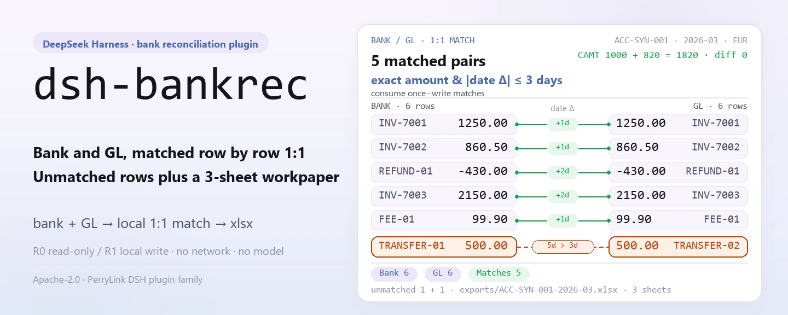
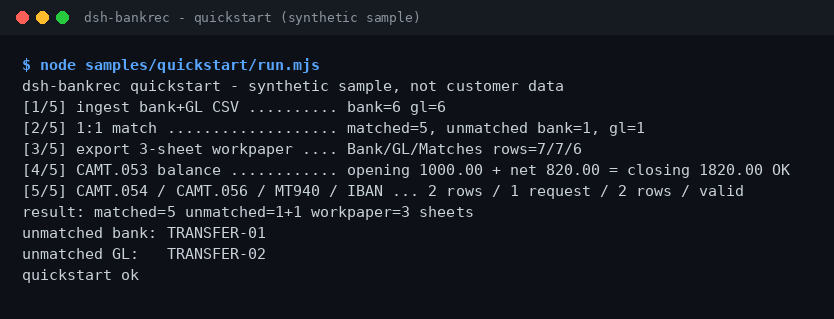

<div align="center">

<picture>
  <source media="(prefers-color-scheme: dark)" srcset="docs/assets/dsh-bankrec-hero-en-dark.webp">
  
</picture>

# dsh-bankrec

**Concilia los extractos bancarios con el GL fila a fila: filas sin conciliar y un papel de trabajo de 3 hojas, todo en tu propia máquina.**

Un plugin de conciliación bancaria para DeepSeek Harness: ingesta de CSV, CAMT.053/054/056 y MT940, conciliación 1:1, verificación de saldos CAMT y exportación de un xlsx `Bank` / `GL` / `Matches`.

[Instalar](#instalación-en-tres-pasos) · [Configuración](#configuración) · [FAQ](#faq) · [简体中文](README.md) · [English](README.en.md) · [Español](README.es.md) · [Português](README.pt.md) · [हिन्दी](README.hi.md)

[](LICENSE)
[](#compatibilidad)
[](https://www.npmjs.com/package/dsh-bankrec)
[](https://github.com/PerryLink/dsh-bankrec/actions/workflows/ci.yml)
[](#compatibilidad)

[](https://github.com/PerryLink/dsh-bankrec/stargazers)
[](https://www.npmjs.com/package/dsh-bankrec)
[](https://dshfind.com/plugins/PerryLink/dsh-bankrec?ref=badge)
[](https://dsh.market/)
[](https://gitee.com/perrylink/dsh-bankrec)

```sh
dsh plugin --profile <profile> add dsh-bankrec
```

</div>

<sub>Plugin comunitario, no afiliado a DeepSeek. Repositorio canónico: <https://github.com/PerryLink/dsh-bankrec> (Gitee es un espejo).</sub>

> **Estado: alpha / sintético público / parcial / no contabilizado / no GA.** Sin evidencia de clientes, datos de clientes ni promesa de producción.

## Qué es

`dsh-bankrec` ingiere extractos bancarios (CSV, CAMT.053/054/056, MT940) y CSV del GL en un dominio de almacenamiento local, concilia filas 1:1 por importe exacto y fecha dentro de ±3 días, verifica que la apertura + los movimientos del CAMT = cierre, y exporta un papel de trabajo xlsx de 3 hojas (`Bank` / `GL` / `Matches`). Todo se ejecuta en tu máquina: sin red, sin llamadas a modelos, sin subidas, y los archivos originales nunca se modifican. Las nueve herramientas llevan el espacio de nombres `bankrec_*`; las operaciones que escriben archivos se marcan R1 (escritura local) y las de solo lectura R0.

- **Adecuado para**: decenas o cientos de filas de extractos bancarios y CSV del GL, o extractos CAMT.053 / CAMT.054 / CAMT.056 y MT940; cuando necesitas un papel de trabajo de 3 hojas que un colega pueda revisar.
- **No adecuado para**: ajustes automáticos de asientos o reescrituras hacia un banco o ERP; este paquete solo comprueba en local y no toma por ti la decisión de aprobación.

<picture>
  <source media="(prefers-color-scheme: dark)" srcset="docs/assets/dsh-bankrec-flow-v5-dark.svg">
  
</picture>

## Instalación en tres pasos

1. **Instalación** (elige un canal):

   ```sh
   # canal npm (recomendado; versiones publicadas)
   dsh plugin --profile <profile> add dsh-bankrec
   # canal git (último main; equivale a git+https://github.com/PerryLink/dsh-bankrec.git)
   dsh plugin --profile <profile> add github:PerryLink/dsh-bankrec
   # canal tarball: pnpm pack en este repo, luego
   dsh plugin --profile <profile> add ./dsh-bankrec-<version>.tgz
   ```

2. **Configuración mínima**: no hay claves de configuración — `cordis.patch.yml` solo `insert`a una fila y los valores por defecto bastan; el único ajuste es la variable de entorno `DSH_BANKREC_HOME` (ver «Configuración»).

3. **Verifica que funciona**:

   ```sh
   dsh --profile <profile> --dump-config | grep dsh-bankrec
   node samples/quickstart/run.mjs
   ```

   El quickstart ejecuta ingesta → conciliación → exportación con la muestra sintética incluida y lo compara con el patrón oro `samples/quickstart/expected/result.json`.

**Desinstalar**: `dsh plugin --profile <profile> remove dsh-bankrec` (o elimina la fila del patch del perfil).

<details>
<summary>Instalar desde el mercado de DSH Desktop</summary>

Todos los plugins de PerryLink están en el mercado integrado de DSH Desktop: **Mercado → Fuentes → Añadir fuente → pega** `https://perrylink-dsh-catalog.perrylink.workers.dev/catalog-source.json` **→ selecciona**. La instalación sigue requiriendo la verificación de identidad npm del mercado y tu confirmación.

</details>

## Capacidades clave

- **Ingesta multiformato** — CSV del banco/GL, CAMT.053, CAMT.054, MT940; IBAN validado según ISO 13616. La ingesta devuelve hashes sha256 de evidencia; los importes se guardan como céntimos enteros.
- **Conciliación 1:1** — `bankrec_match` consume parejas por importe exacto y fecha dentro de ±3 días, guarda las conciliaciones y devuelve las filas sin conciliar de ambos lados.
- **Verificación de saldo CAMT** — `bankrec_reconcile_camt` comprueba apertura + movimientos = cierre; exige `account_id` cuando el extracto es ambiguo.
- **Papel de trabajo de 3 hojas** — `bankrec_export` escribe un xlsx con las hojas `Bank` / `GL` / `Matches` en `exports/`.
- **Cancelaciones de solo lectura** — `bankrec_camt056_list` lista las solicitudes de cancelación CAMT.056; nunca se cancela nada.
- **Totalmente local** — sin llamadas HTTP / DNS / WebSocket en el código; no se conecta a ningún banco, ERP ni servicio en la nube.

### Superficie de herramientas

Los nombres de las herramientas son la API estable (se mantienen en inglés para coincidir con la salida del runtime).

| Herramienta | Propósito | Riesgo |
|---|---|---|
| `bankrec_ingest` | Ingere filas CSV del banco/GL (`date,amount[,reference]`, por cuenta+periodo); céntimos enteros, hashes de evidencia | R1 local write |
| `bankrec_ingest_camt` | Ingere movimientos de extracto CAMT.053 XML (admite DBIT/CRDT) | R1 local write |
| `bankrec_ingest_camt054` | Ingere notificaciones de débito/crédito CAMT.054 (BkToCstmrDbtCdtNtfctn) como filas bancarias | R1 local write |
| `bankrec_ingest_mt940` | Ingere movimientos de extractos MT940 | R1 local write |
| `bankrec_match` | Conciliación 1:1 de filas del banco con las del GL por importe exacto y fecha dentro de ±3 días; guarda conciliaciones y devuelve las no conciliadas | R1 local write |
| `bankrec_reconcile_camt` | Comprueba apertura + movimientos = cierre del CAMT; exige `account_id` cuando es ambiguo | R0 |
| `bankrec_export` | Exporta un xlsx de 3 hojas: Bank / GL / Matches | R1 local write |
| `bankrec_iban_check` | Valida un IBAN según ISO 13616 (juego de caracteres, longitud, longitud BBAN por país, mod-97) | R0 |
| `bankrec_camt056_list` | Lista solicitudes de cancelación CAMT.056 (id de transacción original, id extremo a extremo, código de motivo, cuenta); solo lectura, no se cancela nada | R0 |

### Entrada y salida

Entrada:

- CSV de extracto bancario y CSV del GL: UTF-8, fila de cabecera con al menos `date,amount`, opcional `reference`; fechas `YYYY-MM-DD`; importes con dos decimales como máximo, salidas en negativo.
- XML CAMT.053 / CAMT.054 / CAMT.056 (ISO 20022), o texto MT940 (con `:25:` y `:61:`).
- Cadenas IBAN (ISO 13616) para validación.
- Las herramientas no imponen límite de tamaño; se recomienda ≤5 MB por archivo. La muestra incluida está en `samples/quickstart/input/` (sintética, muy por debajo de 500 KB).

Salida:

- Resumen en terminal: cuántas conciliaron y cuántas filas del banco/GL quedaron sin conciliar.
- Papel de trabajo de 3 hojas: `$DSH_HOME/storages/dsh-bankrec/exports/<cuenta>-<periodo>.xlsx` con las hojas `Bank` / `GL` / `Matches`.
- Los archivos originales nunca se modifican.

### Ejemplos

Copia esta frase tal cual (el prompt de demostración de `package.json`):

```text
帮我用自带样例跑一次银行流水对账，告诉我匹配了几笔、还有哪几笔没对上，并导出三张表的底稿。
```

O ejecútalo tú mismo (una ejecución real; la captura proviene de este comando):

```sh
node samples/quickstart/run.mjs
```



*Muestra sintética → patrón oro `samples/quickstart/expected/result.json`; comando y hashes en `screenshots.json`.*

Ejemplo con fixture: entrada [`fixtures/public/mit-camt/example-camt053-a.xml`](https://github.com/PerryLink/dsh-bankrec/blob/main/fixtures/public/mit-camt/example-camt053-a.xml) (muestra MIT pública); comando `pnpm test`.

Aceptación: `node scripts/acceptance.mjs`, detalles en `ACCEPTANCE.csv` (las 11 filas pasan; las filas SKU son `counted=false`, PS1-QS01 es la reproducción de la muestra incluida `counted=true`):

```csv
req_id,metric,threshold,actual,pass,source,counted
SKU-06-A01,流水解析（30）,30/30,30,true,public/synthetic,false
SKU-06-A02,1:1 匹配,30/30,30,true,public/synthetic,false
SKU-06-A03,未达行,0,0,true,public/synthetic,false
SKU-06-A04,底稿 sheet,3,3,true,public/synthetic,false
SKU-06-A05,CAMT.053 公开样本行,11,11,true,public/synthetic,false
SKU-06-A06,CAMT 余额恒等式,1/1,1,true,public/synthetic,false
SKU-06-A07,MT940 公开样本行,5,5,true,public/synthetic,false
SKU-06-A08,IBAN ISO 13616 mod-97,1/1,1,true,public/synthetic,false
SKU-06-A09,CAMT.054 通知行,2,2,true,public/synthetic,false
SKU-06-A10,CAMT.056 取消请求,1,1,true,public/synthetic,false
PS1-QS01,quickstart 样例与金标一致,1/1,1,true,synthetic/quickstart,true
```

*Son filas de aceptación respaldadas por fixtures/muestras, no ejecuciones de clientes; las columnas completas (incl. `script` y `evidence_sha256`) están en [`ACCEPTANCE.csv`](ACCEPTANCE.csv).*

## Configuración

Este plugin no tiene claves de configuración Schemastery: `cordis.patch.yml` solo `insert`a una fila (`id: dsh-bankrec`) y los valores por defecto bastan.

| Clave | Valor por defecto | Significado |
|---|---|---|
| `DSH_BANKREC_HOME` (variable de entorno) | `$DSH_HOME/storages/dsh-bankrec` | Directorio raíz del índice de conciliación (tablas transactions / matches) y de `exports/*.xlsx`; si `DSH_HOME` no está definida, recurre a `storages/dsh-bankrec` bajo el cwd del proceso anfitrión |

## FAQ

<details>
<summary>¿La instalación falla? ¿Qué hago?</summary>

Comprueba que DSH sea `>=0.2.1-rc.3 <0.4.0` y Node `>=24.9 <25`, y reintenta con un `DSH_HOME` nuevo; los pasos completos están en [`TROUBLESHOOTING.md`](TROUBLESHOOTING.md).

</details>

<details>
<summary>Los importes son idénticos, ¿por qué no conciliaron?</summary>

La conciliación consume parejas 1:1 con «importe exactamente igual + fechas dentro de ±3 días»; un céntimo de diferencia o más de 3 días cae en las filas no conciliadas — revísalas por las referencias no conciliadas del resumen.

</details>

<details>
<summary>¿Puede procesar mis extractos bancarios reales?</summary>

Se ejecuta en local, pero el paquete es alpha y está validado solo con datos públicos/sintéticos — no es una conclusión de auditoría; anonimiza los datos reales primero y mantén un revisor humano.

</details>

<details>
<summary>¿Dónde viven los datos? ¿Se sube algo?</summary>

Solo se escribe `$DSH_HOME/storages/dsh-bankrec` (o el directorio al que apunte `DSH_BANKREC_HOME`): el índice de conciliación y el xlsx exportado. Sin red, sin subidas; los archivos originales nunca se modifican.

</details>

## Límites de seguridad

- **Alcance de lectura**: solo los CSV del banco/GL, XML CAMT, texto MT940 e IBAN que llegan a través de la sesión; no se lee ningún otro directorio.
- **Alcance de escritura**: solo el dominio de almacenamiento `dsh-bankrec` (índice de conciliación) y `exports/*.xlsx`; las rutas de exportación pasan por una comprobación `safe-path` contra escapes de directorio; los originales nunca se modifican.
- **Sin red**: el código no contiene llamadas HTTP / DNS / WebSocket; no se conecta a ningún banco, ERP ni servicio en la nube, y no sube nada.
- **Hashes de evidencia**: tanto la ingesta como la exportación devuelven sha256 para la pista de revisión.
- **Etiquetas de riesgo**: las herramientas que escriben archivos se marcan R1 (escritura local), las de solo lectura R0; consulta la tabla por herramienta en «Capacidades clave».

## Limitaciones conocidas

- **Validación solo pública/sintética**: alpha / parcial / no contabilizado / no GA; sin datos ni evidencia de clientes, y sin promesa de producción.
- **Regla de conciliación rígida**: los importes deben coincidir exactamente (céntimos enteros) y las fechas estar dentro de ±3 días; un céntimo o un día de más cae en las no conciliadas y requiere revisión humana.
- **Restricciones de formato de entrada**: el CSV es UTF-8 con cabecera de al menos `date,amount` (opcional `reference`); las fechas son `YYYY-MM-DD`; los importes llevan dos decimales como máximo, salidas en negativo. Las herramientas no imponen límite de tamaño; se recomienda ≤5 MB por archivo.
- **Sin ajustes automáticos**: solo comprobación local — nada se reescribe hacia un banco o ERP, y no se toma por ti ninguna decisión de aprobación; las solicitudes de cancelación CAMT.056 se listan, nunca se ejecutan.
- **Límites exactos**: los límites por herramienta son la tabla anterior y `ACCEPTANCE.csv`.

## Compatibilidad

| Superficie | Estado |
|---|---|
| Harness | `dsh >=0.2.1-rc.3 <0.4.0` |
| Node | `>=24.9.0 <25` |
| Plataformas | Dondequiera que DSH se ejecute; solo archivos locales |
| Datos | Sin red, sin llamada a modelos, sin subidas |

## Ecosistema y calidad

- [Espejo en Gitee](https://gitee.com/perrylink/dsh-bankrec) (espejo sincronizado; GitHub es el canónico)
- [Página del plugin en dshfind](https://dshfind.com/plugins/PerryLink/dsh-bankrec) (instalaciones y clasificación)
- [DSH Market](https://dsh.market/) (listado)
- **Canal de la tienda 1024**: `npm i -g dsh1024` una vez, luego `dsh1024 plugin --profile <profile> add dsh-bankrec` (cuenta para la clasificación de instalaciones de [deepseek1024.com](https://deepseek1024.com))
- Documentación: [`TROUBLESHOOTING.md`](TROUBLESHOOTING.md) · [`PRIVACY.md`](PRIVACY.md) · [`SECURITY.md`](SECURITY.md) · [Índice de dominio](https://perrylink.github.io/dsh-plugins/) · [Familia de checkers](https://perrylink.github.io/zh/checkers/) · [Artículo de escenario](https://perrylink.github.io/dsh-plugins/articles/finops-suite.html)
- Paquetes hermanos: [dsh-einvoice](https://github.com/PerryLink/dsh-einvoice) · [dsh-ap-three-way](https://github.com/PerryLink/dsh-ap-three-way) · [dsh-travel-recon](https://github.com/PerryLink/dsh-travel-recon) · [dsh-finops-suite](https://github.com/PerryLink/dsh-finops-suite)

Verificadores relacionados (cada uno es un paquete independiente con su propio paquete de reglas y versión; instala solo los que necesites):

| Paquete | Por qué es relevante |
|---|---|
| [`dsh-excel-reconcile`](https://github.com/PerryLink/dsh-excel-reconcile) | Conciliación genérica de dos tablas por clave y tolerancia. |
| [`dsh-invoice-ledger`](https://github.com/PerryLink/dsh-invoice-ledger) | Comprobaciones de duplicados, aritmética y partes del lado de la factura cuando las líneas bancarias llevan referencias de factura. |

## Desarrollo

```sh
pnpm install --frozen-lockfile
pnpm build && pnpm lint && pnpm typecheck && pnpm test   # build tsc + node --test test/*.test.mjs
node scripts/acceptance.mjs                              # aceptación (11 filas), detalles en ACCEPTANCE.csv
pnpm run pack:check                                      # verificación dry-run del contenido publicado
node samples/quickstart/run.mjs                          # reproduce la muestra sintética incluida
```

El código TypeScript está en `src/` (`src/core/` para parseo y conciliación, `src/plugin/` para la cara del anfitrión); la salida de compilación va a `lib/`; las fixtures en `fixtures/`; la muestra incluida en `samples/quickstart/`. El hero y el diagrama de estructura los genera programáticamente [`scripts/gen-readme-assets.py`](scripts/gen-readme-assets.py) (Python/Pillow y SVG escrito a mano; escribe `docs/assets/dsh-bankrec-hero-{zh,en}-{light,dark}.webp` y `docs/assets/dsh-bankrec-flow-v5-{light,dark}.svg`) y se pueden reejecutar sin riesgo.

Topics: `deepseek-harness`, `dsh`, `dsh-plugin`, `bank-rec`, `reconciliation`, `finance`, `perrylink`, `camt`, `mt940`

## Familia y agradecimientos

Este proyecto forma parte de la familia de plugins de DeepSeek Harness de [PerryLink](https://github.com/PerryLink) (todos Apache-2.0). Si te resulta útil, **una estrella ayuda a que la siguiente persona lo encuentre** — nada queda bloqueado tras ella.

- [@PerryLink](https://github.com/PerryLink) — creador y mantenedor: los parseadores CSV / CAMT.053/054/056 / MT940, el motor de conciliación 1:1, la verificación de saldos CAMT, la validación IBAN, la exportación del papel de trabajo de 3 hojas y la documentación en cinco idiomas.

## Licencia

[LICENSE](LICENSE) (Apache License 2.0) © 2026 dsh-bankrec contributors; véase también `NOTICE` y `THIRD-PARTY-NOTICES`.

<p align="center"><sub>Apache-2.0 · Plugin comunitario, no afiliado a DeepSeek.</sub></p>
