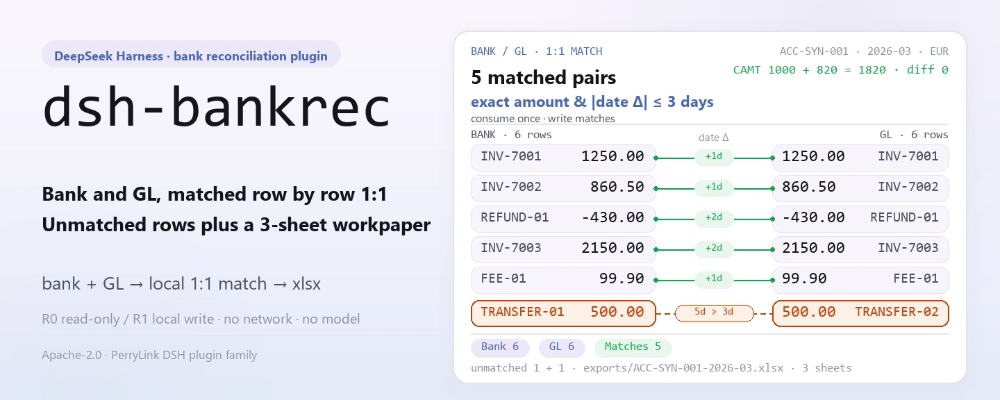
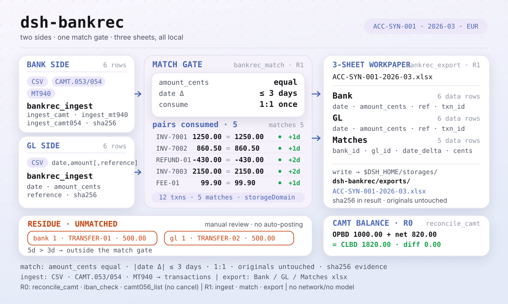
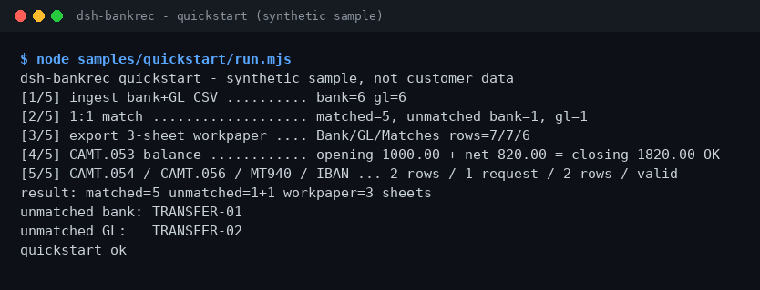

<div align="center">

<picture>
  <source media="(prefers-color-scheme: dark)" srcset="docs/assets/dsh-bankrec-hero-en-dark.webp">
  
</picture>

# dsh-bankrec

**बैंक स्टेटमेंट की GL से पंक्ति-दर-पंक्ति तुलना करें — बिना मिली पंक्तियाँ और 3-शीट वर्कपेपर, पूरी तरह आपकी अपनी मशीन पर।**

DeepSeek Harness के लिए बैंक-रिकंसिलिएशन प्लगइन: CSV, CAMT.053/054/056 और MT940 अंतर्ग्रहण, 1:1 मिलान, CAMT शेष सत्यापन, और `Bank` / `GL` / `Matches` xlsx निर्यात।

[इंस्टॉल](#तीन-चरणों-में-शुरुआत) · [कॉन्फ़िगरेशन](#कॉन्फ़िगरेशन) · [FAQ](#faq) · [简体中文](README.md) · [English](README.en.md) · [Español](README.es.md) · [Português](README.pt.md) · [हिन्दी](README.hi.md)

[](LICENSE)
[](#संगतता)
[](https://www.npmjs.com/package/dsh-bankrec)
[](https://github.com/PerryLink/dsh-bankrec/actions/workflows/ci.yml)
[](#संगतता)

[](https://github.com/PerryLink/dsh-bankrec/stargazers)
[](https://www.npmjs.com/package/dsh-bankrec)
[](https://dshfind.com/plugins/PerryLink/dsh-bankrec?ref=badge)
[](https://dsh.market/)
[](https://gitee.com/perrylink/dsh-bankrec)

```sh
dsh plugin --profile <profile> add dsh-bankrec
```

</div>

<sub>सामुदायिक प्लगइन, DeepSeek से संबद्ध नहीं। आधिकारिक रिपॉज़िटरी: <https://github.com/PerryLink/dsh-bankrec> (Gitee एक मिरर है)।</sub>

> **स्थिति: alpha / सार्वजनिक-सिंथेटिक / आंशिक / गिना नहीं गया / GA नहीं।** ग्राहक साक्ष्य, ग्राहक डेटा या उत्पादन-तैयारी का दावा नहीं।

## यह क्या है

`dsh-bankrec` बैंक स्टेटमेंट (CSV, CAMT.053/054/056, MT940) और GL CSV को स्थानीय स्टोरेज डोमेन में इनजेस्ट करता है, पंक्तियों का सटीक राशि और ±3 दिनों के भीतर तिथि से 1:1 मिलान करता है, CAMT प्रारंभिक + प्रविष्टियाँ = समापन सत्यापित करता है, और 3-शीट xlsx वर्कपेपर (`Bank` / `GL` / `Matches`) निर्यात करता है। सब कुछ आपकी मशीन पर चलता है: नेटवर्क नहीं, मॉडल कॉल नहीं, अपलोड नहीं — और मूल फ़ाइलें कभी संशोधित नहीं होतीं। नौों टूल `bankrec.*` नेमस्पेस में हैं; फ़ाइल लिखने वाली क्रियाएँ R1 (स्थानीय लेखन) और केवल-पठन क्रियाएँ R0 चिह्नित हैं।

- **किसके लिए उपयुक्त**: कुछ दसियों से कुछ सैकड़ों बैंक-स्टेटमेंट और GL CSV पंक्तियाँ, या CAMT.053 / CAMT.054 / CAMT.056 और MT940 स्टेटमेंट; जब आपको ऐसा 3-शीट वर्कपेपर चाहिए जिसे कोई सहकर्मी समीक्षा कर सके।
- **किसके लिए नहीं**: स्वचालित पोस्टिंग समायोजन या बैंक/ERP में वापस-लेखन; यह पैकेज केवल स्थानीय जाँच करता है और आपके लिए अनुमोदन निर्णय नहीं लेता।

<picture>
  <source media="(prefers-color-scheme: dark)" srcset="docs/assets/dsh-bankrec-flow-v5-dark.svg">
  
</picture>

## तीन चरणों में शुरुआत

1. **इंस्टॉल** (कोई एक चैनल चुनें):

   ```sh
   # npm चैनल (अनुशंसित; प्रकाशित संस्करण)
   dsh plugin --profile <profile> add dsh-bankrec
   # git चैनल (नवीनतम main; git+https://github.com/PerryLink/dsh-bankrec.git के समतुल्य)
   dsh plugin --profile <profile> add github:PerryLink/dsh-bankrec
   # tarball चैनल: इस रेपो में pnpm pack, फिर
   dsh plugin --profile <profile> add ./dsh-bankrec-<version>.tgz
   ```

2. **न्यूनतम कॉन्फ़िगरेशन**: कोई कॉन्फ़िगरेशन कुंजी नहीं है — `cordis.patch.yml` केवल एक पंक्ति `insert` करता है और डिफ़ॉल्ट ही पर्याप्त हैं; एकमात्र समायोज्य पर्यावरण चर `DSH_BANKREC_HOME` है (देखें «कॉन्फ़िगरेशन»)।

3. **सत्यापित करें कि यह काम करता है**:

   ```sh
   dsh --profile <profile> --dump-config | grep dsh-bankrec
   node samples/quickstart/run.mjs
   ```

   quickstart bundled सिंथेटिक नमूने पर इनजेस्ट → मिलान → निर्यात चलाता है और गोल्डन `samples/quickstart/expected/result.json` से तुलना करता है।

**अनइंस्टॉल**: `dsh plugin --profile <profile> remove dsh-bankrec` (या प्रोफ़ाइल patch से वह पंक्ति हटाएँ)।

<details>
<summary>DSH Desktop मार्केट से इंस्टॉल करें</summary>

सभी PerryLink प्लगइन DSH Desktop के अंतर्निहित मार्केट में सूचीबद्ध हैं: **Market → Sources → Add source → पेस्ट करें** `https://perrylink-dsh-catalog.perrylink.workers.dev/catalog-source.json` **→ चुनें**। इंस्टॉलेशन के लिए मार्केट की npm पहचान जाँच और आपकी पुष्टि अभी भी आवश्यक है।

</details>

## मुख्य क्षमताएँ

- **बहु-प्रारूप इनजेस्ट** — बैंक/GL CSV, CAMT.053, CAMT.054, MT940; IBAN की ISO 13616 अनुसार वैधता। इनजेस्ट sha256 साक्ष्य हैश लौटाता है; राशियाँ पूर्णांक सेंट में रहती हैं।
- **1:1 मिलान** — `bankrec.match` सटीक राशि और ±3 दिनों के भीतर तिथि से जोड़े खपत करता है, मिलान सहेजता है और दोनों ओर की बिना मिली पंक्तियाँ लौटाता है।
- **CAMT शेष जाँच** — `bankrec.reconcile_camt` प्रारंभिक + प्रविष्टियाँ = समापन सत्यापित करता है; अस्पष्ट स्टेटमेंट पर `account_id` आवश्यक।
- **3-शीट वर्कपेपर** — `bankrec.export` `exports/` के तहत `Bank` / `GL` / `Matches` शीट वाला xlsx लिखता है।
- **केवल-पठन रद्दीकरण** — `bankrec.camt056_list` CAMT.056 रद्दीकरण अनुरोध सूचीबद्ध करता है; कुछ भी रद्द नहीं किया जाता।
- **पूरी तरह स्थानीय** — स्रोत में कोई HTTP / DNS / WebSocket कॉल नहीं; किसी बैंक, ERP या क्लाउड सेवा से कनेक्ट नहीं करता।

### टूल सतह

टूल नाम स्थिर API हैं (रनटाइम आउटपुट से मेल के लिए अंग्रेज़ी में रखे गए)।

| टूल | उद्देश्य | जोखिम |
|---|---|---|
| `bankrec.ingest` | बैंक/GL CSV पंक्तियाँ इनजेस्ट करें (`date,amount[,reference]`, प्रति खाता+अवधि); पूर्णांक सेंट, साक्ष्य हैश | R1 local write |
| `bankrec.ingest_camt` | CAMT.053 XML स्टेटमेंट प्रविष्टियाँ इनजेस्ट करें (DBIT/CRDT समर्थित) | R1 local write |
| `bankrec.ingest_camt054` | CAMT.054 डेबिट/क्रेडिट सूचनाएँ (BkToCstmrDbtCdtNtfctn) बैंक पंक्तियों के रूप में इनजेस्ट करें | R1 local write |
| `bankrec.ingest_mt940` | MT940 स्टेटमेंट प्रविष्टियाँ इनजेस्ट करें | R1 local write |
| `bankrec.match` | बैंक पंक्तियों का GL पंक्तियों से सटीक राशि और ±3 दिनों के भीतर तिथि से 1:1 मिलान; मिलान सहेजता है, बिना मिली लौटाता है | R1 local write |
| `bankrec.reconcile_camt` | CAMT प्रारंभिक + प्रविष्टियाँ = समापन जाँचें; अस्पष्ट होने पर `account_id` आवश्यक | R0 |
| `bankrec.export` | 3-शीट xlsx निर्यात करें: Bank / GL / Matches | R1 local write |
| `bankrec.iban_check` | IBAN की ISO 13616 अनुसार वैधता (वर्णसेट, लंबाई, देश-वार BBAN लंबाई, mod-97) | R0 |
| `bankrec.camt056_list` | CAMT.056 रद्दीकरण अनुरोध सूचीबद्ध करें (मूल लेनदेन id, एंड-टू-एंड id, कारण कोड, खाता); केवल-पठन, कुछ रद्द नहीं होता | R0 |

### इनपुट और आउटपुट

इनपुट:

- बैंक-स्टेटमेंट CSV और GL CSV: UTF-8, हेडर पंक्ति में कम से कम `date,amount`, वैकल्पिक `reference`; तिथियाँ `YYYY-MM-DD`; राशियाँ अधिकतम दो दशमलव तक, आउटफ़्लो ऋणात्मक।
- CAMT.053 / CAMT.054 / CAMT.056 XML (ISO 20022), या MT940 टेक्स्ट (`:25:` और `:61:` सहित)।
- वैधता के लिए IBAN स्ट्रिंग (ISO 13616)।
- टूल पर कोई कठोर आकार सीमा नहीं; प्रति फ़ाइल ≤5 MB रखें। bundled नमूना `samples/quickstart/input/` में है (सिंथेटिक, 500 KB से काफी कम)।

आउटपुट:

- टर्मिनल सारांश: कितने मिले, और कितनी बैंक/GL पंक्तियाँ बिना मिलीं।
- 3-शीट वर्कपेपर: `$DSH_HOME/storages/dsh-bankrec/exports/<खाता>-<अवधि>.xlsx`, शीट `Bank` / `GL` / `Matches`।
- मूल फ़ाइलें कभी संशोधित नहीं होतीं।

### उदाहरण

यह वाक्य यथावत कॉपी करें (`package.json` का डेमो प्रॉम्प्ट):

```text
帮我用自带样例跑一次银行流水对账，告诉我匹配了几笔、还有哪几笔没对上，并导出三张表的底稿。
```

या स्वयं चलाएँ (वास्तविक रन; स्क्रीनशॉट इसी कमांड से है):

```sh
node samples/quickstart/run.mjs
```



*सिंथेटिक नमूना → गोल्डन `samples/quickstart/expected/result.json`; कमांड और हैश `screenshots.json` में।*

fixture-आधारित उदाहरण: इनपुट [`fixtures/public/mit-camt/example-camt053-a.xml`](https://github.com/PerryLink/dsh-bankrec/blob/main/fixtures/public/mit-camt/example-camt053-a.xml) (सार्वजनिक MIT नमूना); कमांड `pnpm test`।

स्वीकृति: `node scripts/acceptance.mjs`, विवरण `ACCEPTANCE.csv` में (सभी 11 पंक्तियाँ पास; SKU पंक्तियाँ `counted=false`, PS1-QS01 bundled-नमूना पुनःस्थापना `counted=true`):

```csv
req_id,metric,threshold,actual,pass,source,counted
SKU-06-A01,流水解析（30）,30/30,30,true,public/synthetic,false
SKU-06-A02,1:1 匹配,30/30,30,true,public/synthetic,false
SKU-06-A03,未达行,0,0,true,public/synthetic,false
SKU-06-A04,底稿 sheet,3,3,true,public/synthetic,false
SKU-06-A05,CAMT.053 公开样本行,11,11,true,public/synthetic,false
SKU-06-A06,CAMT 余额恒等式,1/1,1,true,public/synthetic,false
SKU-06-A07,MT940 公开样本行,5,5,true,public/synthetic,false
SKU-06-A08,IBAN ISO 13616 mod-97,1/1,1,true,public/synthetic,false
SKU-06-A09,CAMT.054 通知行,2,2,true,public/synthetic,false
SKU-06-A10,CAMT.056 取消请求,1,1,true,public/synthetic,false
PS1-QS01,quickstart 样例与金标一致,1/1,1,true,synthetic/quickstart,true
```

*ये fixture/नमूना-आधारित स्वीकृति पंक्तियाँ हैं, ग्राहक रन नहीं; पूर्ण कॉलम (`script` और `evidence_sha256` सहित) [`ACCEPTANCE.csv`](ACCEPTANCE.csv) में हैं।*

## कॉन्फ़िगरेशन

इस प्लगइन में कोई Schemastery कॉन्फ़िगरेशन कुंजी नहीं है: `cordis.patch.yml` केवल एक पंक्ति `insert` करता है (`id: dsh-bankrec`) और डिफ़ॉल्ट ही पर्याप्त हैं।

| कुंजी | डिफ़ॉल्ट | अर्थ |
|---|---|---|
| `DSH_BANKREC_HOME` (पर्यावरण चर) | `$DSH_HOME/storages/dsh-bankrec` | रिकंसिलिएशन इंडेक्स (transactions / matches तालिकाएँ) और `exports/*.xlsx` की रूट निर्देशिका; `DSH_HOME` सेट न होने पर होस्ट प्रोसेस cwd के तहत `storages/dsh-bankrec` पर वापस जाता है |

## FAQ

<details>
<summary>इंस्टॉल विफल हो जाए तो क्या करें?</summary>

जाँचें कि DSH `>=0.2.1-rc.3 <0.4.0` और Node `>=24.9 <25` है, फिर नए `DSH_HOME` के साथ पुनः प्रयास करें; पूरे चरण [`TROUBLESHOOTING.md`](TROUBLESHOOTING.md) में हैं।

</details>

<details>
<summary>राशि एक जैसी है — फिर मिलान क्यों नहीं हुआ?</summary>

मिलान «बिल्कुल समान राशि + ±3 दिनों के भीतर तिथि» से जोड़े 1:1 खपत करता है; एक सेंट का अंतर या 3 दिन से अधिक अंतर बिना-मिली पंक्तियों में चला जाता है — सारांश की बिना-मिली रेफरेंस से मानवीय समीक्षा करें।

</details>

<details>
<summary>क्या यह मेरे वास्तविक बैंक स्टेटमेंट संभाल सकता है?</summary>

स्थानीय रूप से चलता है, लेकिन पैकेज alpha है और केवल सार्वजनिक/सिंथेटिक डेटा पर सत्यापित है — यह लेखापरीक्षा निष्कर्ष नहीं है; वास्तविक डेटा पहले अनामित करें और मानव समीक्षक रखें।

</details>

<details>
<summary>डेटा कहाँ रहता है? क्या कुछ अपलोड होता है?</summary>

केवल `$DSH_HOME/storages/dsh-bankrec` (या `DSH_BANKREC_HOME` वाली निर्देशिका) लिखी जाती है: रिकंसिलिएशन इंडेक्स और निर्यातित xlsx। नेटवर्क नहीं, अपलोड नहीं; मूल फ़ाइलें कभी संशोधित नहीं होतीं।

</details>

## सुरक्षा सीमाएँ

- **पठन दायरा**: केवल सत्र से आए बैंक/GL CSV, CAMT XML, MT940 टेक्स्ट और IBAN मान; कोई अन्य निर्देशिका नहीं पढ़ी जाती।
- **लेखन दायरा**: केवल `dsh-bankrec` स्टोरेज डोमेन (रिकंसिलिएशन इंडेक्स) और `exports/*.xlsx`; निर्यात पथ डायरेक्टरी-एस्केप के विरुद्ध `safe-path` जाँच से गुजरते हैं; मूल फ़ाइलें कभी संशोधित नहीं होतीं।
- **नेटवर्क नहीं**: स्रोत में कोई HTTP / DNS / WebSocket कॉल नहीं; किसी बैंक, ERP या क्लाउड सेवा से कनेक्शन नहीं, और कुछ अपलोड नहीं।
- **साक्ष्य हैश**: इनजेस्ट और निर्यात दोनों समीक्षा-पथ के लिए sha256 लौटाते हैं।
- **जोखिम लेबल**: फ़ाइल लिखने वाले टूल R1 (स्थानीय लेखन), केवल-पठन टूल R0; प्रति-टूल तालिका «मुख्य क्षमताएँ» में देखें।

## ज्ञात सीमाएँ

- **केवल सार्वजनिक/सिंथेटिक सत्यापन**: alpha / आंशिक / गिना नहीं गया / GA नहीं; ग्राहक डेटा या साक्ष्य नहीं, और उत्पादन-तैयारी का दावा नहीं।
- **कठोर मिलान नियम**: राशि बिल्कुल समान (पूर्णांक सेंट) और तिथि ±3 दिनों के भीतर होनी चाहिए; एक सेंट या एक दिन अधिक होने पर बिना-मिली पंक्तियों में जाता है और मानवीय समीक्षा चाहिए।
- **इनपुट प्रारूप बाधाएँ**: CSV, UTF-8 है जिसकी हेडर पंक्ति में कम से कम `date,amount` (वैकल्पिक `reference`) हो; तिथियाँ `YYYY-MM-DD`; राशि अधिकतम दो दशमलव, आउटफ़्लो ऋणात्मक। टूल कोई कठोर आकार सीमा नहीं रखते; प्रति फ़ाइल ≤5 MB अनुशंसित।
- **स्वतः समायोजन नहीं**: केवल स्थानीय जाँच — बैंक या ERP में कुछ वापस नहीं लिखा जाता, और कोई अनुमोदन निर्णय आपके लिए नहीं लिया जाता; CAMT.056 रद्दीकरण अनुरोध सूचीबद्ध होते हैं, कभी निष्पादित नहीं।
- **सटीक सीमाएँ**: प्रति-टूल सीमाएँ ऊपर की तालिका और `ACCEPTANCE.csv` हैं।

## संगतता

| सतह | स्थिति |
|---|---|
| Harness | `dsh >=0.2.1-rc.3 <0.4.0` |
| Node | `>=24.9.0 <25` |
| प्लेटफ़ॉर्म | जहाँ भी DSH चले; केवल स्थानीय फ़ाइलें |
| डेटा | नेटवर्क नहीं, मॉडल कॉल नहीं, अपलोड नहीं |

## इकोसिस्टम और गुणवत्ता

- [Gitee मिरर](https://gitee.com/perrylink/dsh-bankrec) (सिंक मिरर; GitHub आधिकारिक है)
- [dshfind प्लगइन पेज](https://dshfind.com/plugins/PerryLink/dsh-bankrec) (इंस्टॉल और रैंकिंग)
- [DSH Market](https://dsh.market/) (सूचीबद्ध)
- **1024 स्टोर चैनल**: एक बार `npm i -g dsh1024`, फिर `dsh1024 plugin --profile <profile> add dsh-bankrec` ([deepseek1024.com](https://deepseek1024.com) इंस्टॉल रैंकिंग में गिना जाता है)
- दस्तावेज़: [`TROUBLESHOOTING.md`](TROUBLESHOOTING.md) · [`PRIVACY.md`](PRIVACY.md) · [`SECURITY.md`](SECURITY.md) · [डोमेन सूचकांक](https://perrylink.github.io/dsh-plugins/) · [चेकर परिवार](https://perrylink.github.io/zh/checkers/) · [परिदृश्य लेख](https://perrylink.github.io/dsh-plugins/articles/finops-suite.html)
- सहोदर पैकेज: [dsh-einvoice](https://github.com/PerryLink/dsh-einvoice) · [dsh-ap-three-way](https://github.com/PerryLink/dsh-ap-three-way) · [dsh-travel-recon](https://github.com/PerryLink/dsh-travel-recon) · [dsh-finops-suite](https://github.com/PerryLink/dsh-finops-suite)

संबंधित चेकर (प्रत्येक अपने नियम-पैक और संस्करण वाला अलग पैकेज है; केवल वही इंस्टॉल करें जो चाहिए):

| पैकेज | क्यों प्रासंगिक है |
|---|---|
| [`dsh-excel-reconcile`](https://github.com/PerryLink/dsh-excel-reconcile) | कुंजी और सहनशीलता से सामान्य दो-तालिका रिकंसिलिएशन। |
| [`dsh-invoice-ledger`](https://github.com/PerryLink/dsh-invoice-ledger) | जब बैंक पंक्तियों में चालान संदर्भ हों तो चालान-पक्ष की डुप्लिकेट, अंकगणित और पक्ष जाँचें। |

## डेवलपमेंट

```sh
pnpm install --frozen-lockfile
pnpm build && pnpm lint && pnpm typecheck && pnpm test   # tsc बिल्ड + node --test test/*.test.mjs
node scripts/acceptance.mjs                              # स्वीकृति (11 पंक्तियाँ), विवरण ACCEPTANCE.csv में
pnpm run pack:check                                      # प्रकाशित-सामग्री dry-run जाँच
node samples/quickstart/run.mjs                          # bundled सिंथेटिक नमूना दोबारा चलाएँ
```

TypeScript स्रोत `src/` में हैं (`src/core/` पार्सिंग और मिलान के लिए, `src/plugin/` होस्ट फ़ेस के लिए); बिल्ड आउटपुट `lib/` में; fixtures `fixtures/` में; bundled नमूना `samples/quickstart/` में। hero और संरचना आरेख [`scripts/gen-readme-assets.py`](scripts/gen-readme-assets.py) द्वारा प्रोग्रामेटिक रूप से बनते हैं (Python/Pillow और हस्तलिखित SVG; `docs/assets/dsh-bankrec-hero-{zh,en}-{light,dark}.webp` तथा `docs/assets/dsh-bankrec-flow-v5-{light,dark}.svg` लिखता है) और सुरक्षित रूप से दोबारा चलाए जा सकते हैं।

Topics: `deepseek-harness`, `dsh`, `dsh-plugin`, `bank-rec`, `reconciliation`, `finance`, `perrylink`, `camt`, `mt940`

## परिवार और आभार

यह प्रोजेक्ट [PerryLink](https://github.com/PerryLink) के DeepSeek Harness प्लगइन परिवार का हिस्सा है (सभी Apache-2.0)। अगर यह उपयोगी लगे, तो **एक स्टार अगले व्यक्ति को इसे खोजने में मदद करता है** — स्टार से कोई सुविधा अनलॉक नहीं होती।

- [@PerryLink](https://github.com/PerryLink) — निर्माता और अनुरक्षक: CSV / CAMT.053/054/056 / MT940 पार्सर, 1:1 मिलान इंजन, CAMT शेष जाँच, IBAN वैधता, 3-शीट वर्कपेपर निर्यात और पाँच-भाषा दस्तावेज़।

## लाइसेंस

[LICENSE](LICENSE) (Apache License 2.0) © 2026 dsh-bankrec contributors; `NOTICE` और `THIRD-PARTY-NOTICES` भी देखें।

<p align="center"><sub>Apache-2.0 · सामुदायिक प्लगइन, DeepSeek से संबद्ध नहीं।</sub></p>
