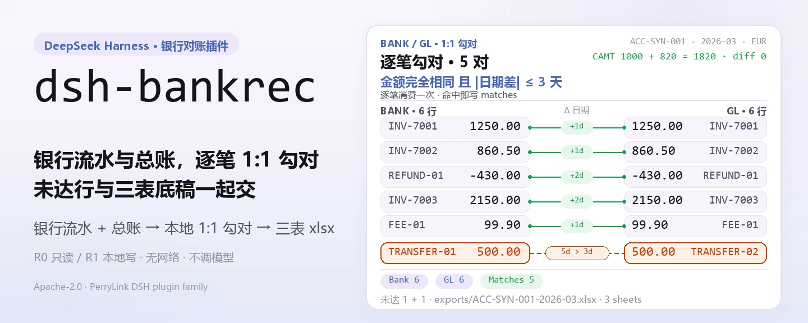
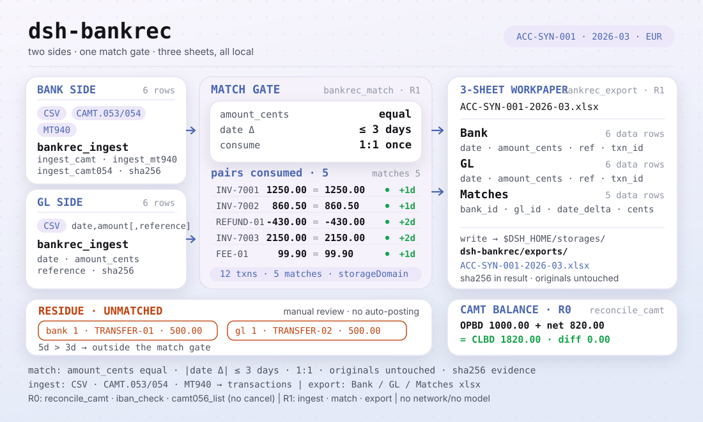
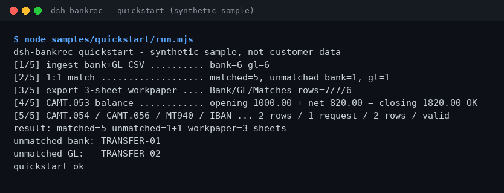

<div align="center">

<picture>
  <source media="(prefers-color-scheme: dark)" srcset="docs/assets/dsh-bankrec-hero-zh-dark.webp">
  
</picture>

# dsh-bankrec

**把银行流水和总账按金额与日期逐笔勾对，输出未达行与三表底稿——全程本地，不联网。**

面向 DeepSeek Harness 的银行对账插件：CSV、CAMT.053/054/056、MT940 入库，1:1 匹配与 CAMT 余额核对，导出 Bank / GL / Matches 三张表的 xlsx 底稿。

[安装](#三步上手) · [配置](#配置) · [FAQ](#faq) · [简体中文](README.md) · [English](README.en.md) · [Español](README.es.md) · [Português](README.pt.md) · [हिन्दी](README.hi.md)

[](LICENSE)
[](#兼容性)
[](https://www.npmjs.com/package/dsh-bankrec)
[](https://github.com/PerryLink/dsh-bankrec/actions/workflows/ci.yml)
[](#兼容性)

[](https://github.com/PerryLink/dsh-bankrec/stargazers)
[](https://www.npmjs.com/package/dsh-bankrec)
[](https://dshfind.com/plugins/PerryLink/dsh-bankrec?ref=badge)
[](https://dsh.market/)
[](https://gitee.com/perrylink/dsh-bankrec)

```sh
dsh plugin --profile <profile> add dsh-bankrec
```

</div>

<sub>社区插件，与 DeepSeek 官方无关。唯一仓库：<https://github.com/PerryLink/dsh-bankrec>（Gitee 为镜像）。</sub>

> **状态：alpha / 公开合成 / partial / not counted / 非 GA。** 不含客户证据、客户数据，也不作生产可用声明。

## 它是什么

把银行流水（CSV、CAMT.053/054/056、MT940）和总账 CSV 入库到本地存储域，按「金额完全相同 + 日期相差 ≤3 天」逐笔 1:1 勾对，核对 CAMT 期初 + 明细 = 期末，最后导出 Bank / GL / Matches 三张表的 xlsx 底稿。全部计算在本机完成：不联网、不调用模型、不上传，原始文件不会被修改。九个工具全部带 `bankrec_*` 命名空间；写文件的操作标 R1（本地写），只读操作标 R0。

- **适合**：几十到几百笔的银行流水与总账 CSV，或 CAMT.053 / CAMT.054 / CAMT.056、MT940 对账单；需要一份能交给同事复核的三表底稿。
- **不适合**：需要自动调账、回写银行或 ERP 的场景；本包只做本地核对，不替你做审批结论。

<picture>
  <source media="(prefers-color-scheme: dark)" srcset="docs/assets/dsh-bankrec-flow-v5-dark.svg">
   3 天）与 CAMT 余额恒等（1000.00 + 820.00 = 1820.00，diff 0.00，只读）">
</picture>

## 三步上手

1. **安装**（三选一）：

   ```sh
   # npm 通道（推荐，已发布版本）
   dsh plugin --profile <profile> add dsh-bankrec
   # git 通道（最新 main；等价于 git+https://github.com/PerryLink/dsh-bankrec.git）
   dsh plugin --profile <profile> add github:PerryLink/dsh-bankrec
   # tarball 通道：本仓库 pnpm pack 后
   dsh plugin --profile <profile> add ./dsh-bankrec-<version>.tgz
   ```

2. **最小配置**：没有配置键——`cordis.patch.yml` 只 `insert` 一行，默认即可用；唯一可调的是环境变量 `DSH_BANKREC_HOME`（见「配置」）。

3. **验证已生效**：

   ```sh
   dsh --profile <profile> --dump-config | grep dsh-bankrec
   node samples/quickstart/run.mjs
   ```

   quickstart 用随包合成样例跑通「入库 → 匹配 → 导出」，并与金标 `samples/quickstart/expected/result.json` 对照。

**卸载**：`dsh plugin --profile <profile> remove dsh-bankrec`（或从 profile patch 删掉该行）。

<details>
<summary>从 DSH Desktop 市场安装</summary>

所有 PerryLink 插件均可在 DSH Desktop 内置市场中浏览：**市场 → 来源 → 添加来源 → 粘贴** `https://perrylink-dsh-catalog.perrylink.workers.dev/catalog-source.json` **→ 选中**。安装仍需通过市场的 npm 身份校验与你的确认。

</details>

## 核心能力

- **多格式入库** —— 银行/总账 CSV、CAMT.053、CAMT.054、MT940；IBAN 按 ISO 13616 校验。入库返回 sha256 证据哈希，金额按整数分记账。
- **1:1 匹配** —— `bankrec_match` 按「金额完全相同 + 日期相差 ≤3 天」逐笔消费，写入匹配并返回两侧未达行。
- **CAMT 余额核对** —— `bankrec_reconcile_camt` 验证期初 + 明细 = 期末；多账户时必须给 `account_id`。
- **三表底稿** —— `bankrec_export` 把 `Bank` / `GL` / `Matches` 三张表导出为 xlsx，落在 `exports/`。
- **只读取消请求** —— `bankrec_camt056_list` 列出 CAMT.056 取消请求，绝不执行取消。
- **纯本地** —— 源码无 HTTP / DNS / WebSocket 调用；不连银行、ERP 或云服务。

### 工具面

工具名是稳定 API（与运行时输出一致，保持英文）；说明已本地化。

| 工具 | 用途 | 风险 |
|---|---|---|
| `bankrec_ingest` | 导入银行/总账 CSV 行（`date,amount[,reference]`，按账户+期间）；整数分，附证据哈希 | R1 local write |
| `bankrec_ingest_camt` | 导入 CAMT.053 XML 对账单条目（支持 DBIT/CRDT） | R1 local write |
| `bankrec_ingest_camt054` | 导入 CAMT.054 借贷通知（BkToCstmrDbtCdtNtfctn）为银行行 | R1 local write |
| `bankrec_ingest_mt940` | 导入 MT940 对账单条目 | R1 local write |
| `bankrec_match` | 银行行与 GL 行按金额完全相同 + 日期相差 ≤3 天做 1:1 匹配；写入匹配并返回未达行 | R1 local write |
| `bankrec_reconcile_camt` | 核对 CAMT 期初 + 明细 = 期末；有歧义时要求 `account_id` | R0 |
| `bankrec_export` | 导出三表 xlsx：Bank / GL / Matches | R1 local write |
| `bankrec_iban_check` | 校验 IBAN（ISO 13616：字符集、长度、国家 BBAN 长度、mod-97） | R0 |
| `bankrec_camt056_list` | 列出 CAMT.056 取消请求（原交易号、端到端号、原因码、账户）；只读，不执行取消 | R0 |

### 输入与输出

输入：

- 银行流水 CSV、总账 CSV：UTF-8，第一行表头至少 `date,amount`，可选 `reference`；日期 `YYYY-MM-DD`，金额最多两位小数，支出用负数。
- CAMT.053 / CAMT.054 / CAMT.056 XML（ISO 20022），或 MT940 文本（含 `:25:` 与 `:61:`）。
- IBAN 字符串（ISO 13616），用于校验。
- 工具不设硬性大小上限；建议单个文件 ≤5 MB。自带样例在 `samples/quickstart/input/`（合成数据，远小于 500 KB）。

输出：

- 终端摘要：对上几笔、银行未达几笔、总账未达几笔。
- 三表底稿：`$DSH_HOME/storages/dsh-bankrec/exports/<账户>-<期间>.xlsx`，工作表 `Bank` / `GL` / `Matches`。
- 原文件不会被修改。

### 示例

直接复制这句话（`package.json` 里的演示提示词）：

```text
帮我用自带样例跑一次银行流水对账，告诉我匹配了几笔、还有哪几笔没对上，并导出三张表的底稿。
```

也可以自己跑（真实运行，截图即来自这条命令）：

```sh
node samples/quickstart/run.mjs
```



*合成样例 → 金标 `samples/quickstart/expected/result.json`；命令与哈希见 `screenshots.json`。*

fixture 示例：输入 [`fixtures/public/mit-camt/example-camt053-a.xml`](https://github.com/PerryLink/dsh-bankrec/blob/main/fixtures/public/mit-camt/example-camt053-a.xml)（公开 MIT 样本）；命令 `pnpm test`。

验收：`node scripts/acceptance.mjs`，明细见 `ACCEPTANCE.csv`（11 行全部通过；SKU 行 `counted=false`，PS1-QS01 为随包样例本地复现 `counted=true`）：

```csv
req_id,metric,threshold,actual,pass,source,counted
SKU-06-A01,流水解析（30）,30/30,30,true,public/synthetic,false
SKU-06-A02,1:1 匹配,30/30,30,true,public/synthetic,false
SKU-06-A03,未达行,0,0,true,public/synthetic,false
SKU-06-A04,底稿 sheet,3,3,true,public/synthetic,false
SKU-06-A05,CAMT.053 公开样本行,11,11,true,public/synthetic,false
SKU-06-A06,CAMT 余额恒等式,1/1,1,true,public/synthetic,false
SKU-06-A07,MT940 公开样本行,5,5,true,public/synthetic,false
SKU-06-A08,IBAN ISO 13616 mod-97,1/1,1,true,public/synthetic,false
SKU-06-A09,CAMT.054 通知行,2,2,true,public/synthetic,false
SKU-06-A10,CAMT.056 取消请求,1,1,true,public/synthetic,false
PS1-QS01,quickstart 样例与金标一致,1/1,1,true,synthetic/quickstart,true
```

*以上为 fixture/样例支撑的验收行，非客户运行；完整列（含 `script` 与 `evidence_sha256`）见 [`ACCEPTANCE.csv`](ACCEPTANCE.csv)。*

## 配置

本插件没有 Schemastery 配置键：`cordis.patch.yml` 只 `insert` 一行（`id: dsh-bankrec`），默认即可用。

| 键 | 默认值 | 含义 |
|---|---|---|
| `DSH_BANKREC_HOME`（环境变量） | `$DSH_HOME/storages/dsh-bankrec` | 对账索引（transactions / matches 表）与 `exports/*.xlsx` 的存放根目录；未设 `DSH_HOME` 时退回宿主进程 cwd 下的 `storages/dsh-bankrec` |

## FAQ

<details>
<summary>装不上怎么办？</summary>

确认 DSH `>=0.2.1-rc.3 <0.4.0`、Node `>=24.9 <25`，并用全新的 `DSH_HOME` 重试；完整步骤见 [`TROUBLESHOOTING.md`](TROUBLESHOOTING.md)。

</details>

<details>
<summary>金额明明一样，为什么没匹配上？</summary>

匹配按「金额完全相同 + 日期相差 ≤3 天」逐笔 1:1 消费；差 1 分或日期超过 3 天都会进入未达行，请按摘要里的未达 reference 人工复核。

</details>

<details>
<summary>能处理我的真实银行流水吗？</summary>

可以本地运行，但本包是 alpha、只用公开/合成数据验证，不构成审计结论；使用真实数据前请脱敏，并保留复核人。

</details>

<details>
<summary>数据存在哪？会不会上传？</summary>

只写 `$DSH_HOME/storages/dsh-bankrec`（或 `DSH_BANKREC_HOME` 指向的目录）：对账索引与导出的 xlsx。不联网、不上传，原文件不被修改。

</details>

## 安全边界

- **读取范围**：仅会话传入的银行流水/总账 CSV、CAMT XML、MT940 文本与 IBAN；不读其他目录。
- **写入范围**：仅 `dsh-bankrec` 存储域（对账索引）与 `exports/*.xlsx`；导出路径经 `safe-path` 校验防目录逃逸；原文件不被修改。
- **无网络**：源码中没有 HTTP / DNS / WebSocket 调用；不连接银行、ERP 或云服务，不上传数据。
- **证据哈希**：入库与导出都返回 sha256，便于复核留痕。
- **风险分级**：写文件的工具标 R1（本地写），只读工具标 R0；逐工具见「核心能力」工具表。

## 已知限制

- **仅公开/合成验证**：alpha / partial / not counted / 非 GA；无客户数据或客户证据，不作生产可用声明。
- **匹配规则刚性**：金额必须完全相同（整数分）且日期相差 ≤3 天；差 1 分或超期都会进入未达行，需要人工复核。
- **输入格式约束**：CSV 为 UTF-8、首行表头至少 `date,amount`（可选 `reference`）；日期 `YYYY-MM-DD`；金额最多两位小数、支出用负数。工具不设硬性大小上限，建议单文件 ≤5 MB。
- **不做自动调账**：只做本地核对，不回写银行或 ERP，不替你做审批结论；CAMT.056 只列出取消请求，不执行取消。
- **精确边界**：每个工具的逐项边界以「核心能力」工具表与 `ACCEPTANCE.csv` 为准。

## 兼容性

| 维度 | 状态 |
|---|---|
| Harness | `dsh >=0.2.1-rc.3 <0.4.0` |
| Node | `>=24.9.0 <25` |
| 平台 | 任何 DSH 可运行处；仅本地文件 |
| 数据 | 不联网、不调用模型、不上传 |

## 生态与质量

- [Gitee 镜像](https://gitee.com/perrylink/dsh-bankrec)（同步镜像，以 GitHub 为准）
- [dshfind 插件页](https://dshfind.com/plugins/PerryLink/dsh-bankrec)（安装量与排名）
- [DSH Market](https://dsh.market/)（已上架）
- **1024 商店渠道**：先 `npm i -g dsh1024`，再 `dsh1024 plugin --profile <profile> add dsh-bankrec`（计入 [deepseek1024.com](https://deepseek1024.com) 安装排行）
- 文档：[`TROUBLESHOOTING.md`](TROUBLESHOOTING.md)（故障排查）· [`PRIVACY.md`](PRIVACY.md) · [`SECURITY.md`](SECURITY.md) · [领域索引](https://perrylink.github.io/dsh-plugins/) · [Checker 家族](https://perrylink.github.io/zh/checkers/) · [场景文章](https://perrylink.github.io/dsh-plugins/articles/finops-suite.html)
- 兄弟包：[dsh-einvoice](https://github.com/PerryLink/dsh-einvoice) · [dsh-ap-three-way](https://github.com/PerryLink/dsh-ap-three-way) · [dsh-travel-recon](https://github.com/PerryLink/dsh-travel-recon) · [dsh-finops-suite](https://github.com/PerryLink/dsh-finops-suite)

相关核查器（各自是独立包，带独立规则包与版本；只装你需要的）：

| 包 | 为什么相关 |
|---|---|
| [`dsh-excel-reconcile`](https://github.com/PerryLink/dsh-excel-reconcile) | 通用两表对账：按键与容差。 |
| [`dsh-invoice-ledger`](https://github.com/PerryLink/dsh-invoice-ledger) | 银行行带发票号时，做发票侧的重复、算术与当事方检查。 |

## 开发

```sh
pnpm install --frozen-lockfile
pnpm build && pnpm lint && pnpm typecheck && pnpm test   # tsc 构建 + node --test test/*.test.mjs
node scripts/acceptance.mjs                              # 验收（11 行），明细见 ACCEPTANCE.csv
pnpm run pack:check                                      # 发布内容 dry-run 校验
node samples/quickstart/run.mjs                          # 合成样例本地复现
```

TypeScript 源码在 `src/`（`src/core/` 解析与匹配、`src/plugin/` 宿主面），构建产物在 `lib/`；fixture 在 `fixtures/`，随包样例在 `samples/quickstart/`。开头 hero 与结构图由 [`scripts/gen-readme-assets.py`](scripts/gen-readme-assets.py) 程序化生成（Python/Pillow + 手写 SVG，输出 `docs/assets/dsh-bankrec-hero-{zh,en}-{light,dark}.webp` 与 `docs/assets/dsh-bankrec-flow-v5-{light,dark}.svg`），可重复执行。

Topics：`deepseek-harness`, `dsh`, `dsh-plugin`, `bank-rec`, `reconciliation`, `finance`, `perrylink`, `camt`, `mt940`

## 家族与致谢

本项目是 [PerryLink](https://github.com/PerryLink) 维护的 DeepSeek Harness 插件家族成员（全部 Apache-2.0）。如果这个插件帮到了你，**给个 star**——它不解锁任何功能，但会让下一个人更容易找到它。

- [@PerryLink](https://github.com/PerryLink) —— 创建者与维护者：CSV / CAMT.053/054/056 / MT940 解析、1:1 匹配引擎、CAMT 余额核对、IBAN 校验、三表底稿导出与五语文档。

## License

[LICENSE](LICENSE)（Apache License 2.0）© 2026 dsh-bankrec contributors；另见 `NOTICE` 与 `THIRD-PARTY-NOTICES`。

<p align="center"><sub>Apache-2.0 · 社区插件，与 DeepSeek 无关。</sub></p>
