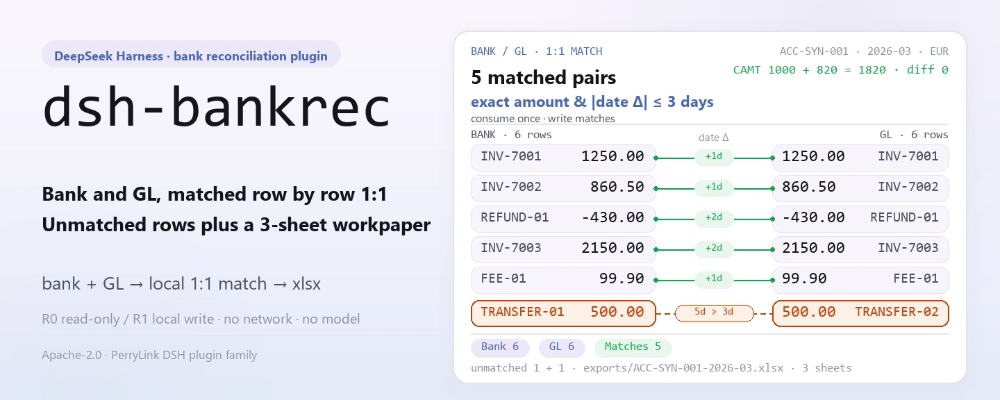
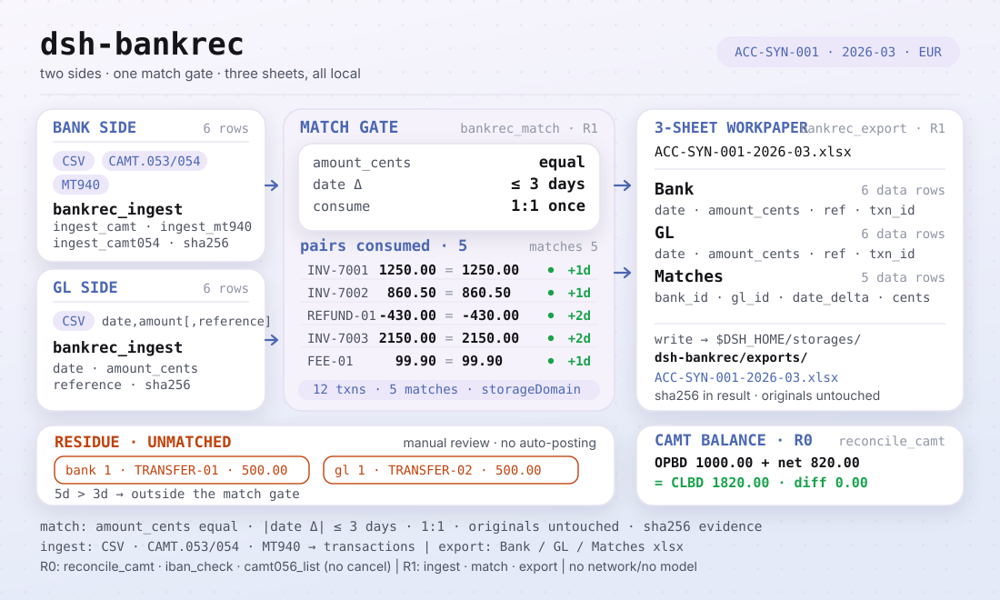
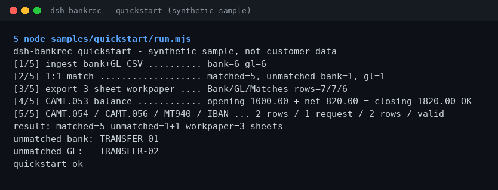

<div align="center">

<picture>
  <source media="(prefers-color-scheme: dark)" srcset="docs/assets/dsh-bankrec-hero-en-dark.webp">
  
</picture>

# dsh-bankrec

**Concilie extratos bancários com o GL linha a linha — linhas não conciliadas e uma planilha de trabalho de 3 abas, tudo na sua própria máquina.**

Um plugin de conciliação bancária para o DeepSeek Harness: ingestão de CSV, CAMT.053/054/056 e MT940, conciliação 1:1, verificação de saldos CAMT e exportação de um xlsx `Bank` / `GL` / `Matches`.

[Instalar](#instalação-em-três-passos) · [Configuração](#configuração) · [FAQ](#faq) · [简体中文](README.md) · [English](README.en.md) · [Español](README.es.md) · [Português](README.pt.md) · [हिन्दी](README.hi.md)

[](LICENSE)
[](#compatibilidade)
[](https://www.npmjs.com/package/dsh-bankrec)
[](https://github.com/PerryLink/dsh-bankrec/actions/workflows/ci.yml)
[](#compatibilidade)

[](https://github.com/PerryLink/dsh-bankrec/stargazers)
[](https://www.npmjs.com/package/dsh-bankrec)
[](https://dshfind.com/plugins/PerryLink/dsh-bankrec?ref=badge)
[](https://dsh.market/)
[](https://gitee.com/perrylink/dsh-bankrec)

```sh
dsh plugin --profile <profile> add dsh-bankrec
```

</div>

<sub>Plugin comunitário, sem afiliação com a DeepSeek. Repositório canônico: <https://github.com/PerryLink/dsh-bankrec> (o Gitee é um espelho).</sub>

> **Status: alpha / sintético público / parcial / não contabilizado / não GA.** Sem evidência de clientes, dados de clientes ou promessa de produção.

## O que é

O `dsh-bankrec` ingere extratos bancários (CSV, CAMT.053/054/056, MT940) e CSV do GL num domínio de armazenamento local, concilia linhas 1:1 por valor exato e data dentro de ±3 dias, verifica abertura + lançamentos = fechamento do CAMT e exporta uma planilha de trabalho xlsx de 3 abas (`Bank` / `GL` / `Matches`). Tudo roda na sua máquina: sem rede, sem chamadas a modelos, sem uploads — e os arquivos originais nunca são modificados. As nove ferramentas usam o namespace `bankrec.*`; operações que gravam arquivos são marcadas R1 (escrita local), as somente leitura R0.

- **Indicado para**: dezenas a centenas de linhas de extratos bancários e CSV do GL, ou extratos CAMT.053 / CAMT.054 / CAMT.056 e MT940; quando você precisa de uma planilha de trabalho de 3 abas que um colega possa revisar.
- **Não indicado para**: ajustes automáticos de lançamentos ou reescrita para um banco ou ERP; este pacote só confere localmente e não toma a decisão de aprovação por você.

<picture>
  <source media="(prefers-color-scheme: dark)" srcset="docs/assets/dsh-bankrec-flow-v5-dark.svg">
  
</picture>

## Instalação em três passos

1. **Instalação** (escolha um canal):

   ```sh
   # canal npm (recomendado; versões publicadas)
   dsh plugin --profile <profile> add dsh-bankrec
   # canal git (main mais recente; equivale a git+https://github.com/PerryLink/dsh-bankrec.git)
   dsh plugin --profile <profile> add github:PerryLink/dsh-bankrec
   # canal tarball: pnpm pack neste repositório, depois
   dsh plugin --profile <profile> add ./dsh-bankrec-<version>.tgz
   ```

2. **Configuração mínima**: não há chaves de configuração — o `cordis.patch.yml` apenas `insert`a uma linha e os padrões bastam; o único ajuste é a variável de ambiente `DSH_BANKREC_HOME` (ver «Configuração»).

3. **Verifique se funciona**:

   ```sh
   dsh --profile <profile> --dump-config | grep dsh-bankrec
   node samples/quickstart/run.mjs
   ```

   O quickstart executa ingestão → conciliação → exportação com a amostra sintética incluída e compara com o gabarito `samples/quickstart/expected/result.json`.

**Desinstalar**: `dsh plugin --profile <profile> remove dsh-bankrec` (ou remova a linha do patch do perfil).

<details>
<summary>Instalar pelo mercado do DSH Desktop</summary>

Todos os plugins PerryLink estão no mercado embutido do DSH Desktop: **Mercado → Fontes → Adicionar fonte → cole** `https://perrylink-dsh-catalog.perrylink.workers.dev/catalog-source.json` **→ selecione**. A instalação ainda exige a verificação de identidade npm do mercado e a sua confirmação.

</details>

## Capacidades principais

- **Ingestão multiformato** — CSV do banco/GL, CAMT.053, CAMT.054, MT940; IBAN validado conforme ISO 13616. A ingestão devolve hashes sha256 de evidência; os valores ficam em centavos inteiros.
- **Conciliação 1:1** — `bankrec.match` consome pares por valor exato e data dentro de ±3 dias, grava as conciliações e devolve as linhas não conciliadas dos dois lados.
- **Verificação de saldo CAMT** — `bankrec.reconcile_camt` confere abertura + lançamentos = fechamento; exige `account_id` quando o extrato é ambíguo.
- **Planilha de trabalho de 3 abas** — `bankrec.export` grava um xlsx com as abas `Bank` / `GL` / `Matches` em `exports/`.
- **Cancelamentos somente leitura** — `bankrec.camt056_list` lista pedidos de cancelamento CAMT.056; nada é cancelado.
- **Totalmente local** — sem chamadas HTTP / DNS / WebSocket no código; não se conecta a nenhum banco, ERP ou serviço de nuvem.

### Superfície de ferramentas

Os nomes das ferramentas são a API estável (mantidos em inglês para corresponder à saída do runtime).

| Ferramenta | Finalidade | Risco |
|---|---|---|
| `bankrec.ingest` | Ingere linhas CSV do banco/GL (`date,amount[,reference]`, por conta+período); centavos inteiros, hashes de evidência | R1 local write |
| `bankrec.ingest_camt` | Ingere lançamentos de extrato CAMT.053 XML (aceita DBIT/CRDT) | R1 local write |
| `bankrec.ingest_camt054` | Ingere notificações de débito/crédito CAMT.054 (BkToCstmrDbtCdtNtfctn) como linhas bancárias | R1 local write |
| `bankrec.ingest_mt940` | Ingere lançamentos de extratos MT940 | R1 local write |
| `bankrec.match` | Conciliação 1:1 de linhas do banco com linhas do GL por valor exato e data dentro de ±3 dias; grava conciliações e devolve as não conciliadas | R1 local write |
| `bankrec.reconcile_camt` | Confere abertura + lançamentos = fechamento do CAMT; exige `account_id` quando ambíguo | R0 |
| `bankrec.export` | Exporta um xlsx de 3 abas: Bank / GL / Matches | R1 local write |
| `bankrec.iban_check` | Valida um IBAN conforme ISO 13616 (conjunto de caracteres, comprimento, comprimento BBAN por país, mod-97) | R0 |
| `bankrec.camt056_list` | Lista pedidos de cancelamento CAMT.056 (id da transação original, id ponta a ponta, código de motivo, conta); somente leitura, nada é cancelado | R0 |

### Entrada e saída

Entrada:

- CSV de extrato bancário e CSV do GL: UTF-8, linha de cabeçalho com pelo menos `date,amount`, opcional `reference`; datas `YYYY-MM-DD`; valores com no máximo duas casas decimais, saídas em negativo.
- XML CAMT.053 / CAMT.054 / CAMT.056 (ISO 20022), ou texto MT940 (com `:25:` e `:61:`).
- Strings IBAN (ISO 13616) para validação.
- As ferramentas não impõem limite de tamanho; recomenda-se ≤5 MB por arquivo. A amostra incluída fica em `samples/quickstart/input/` (sintética, bem abaixo de 500 KB).

Saída:

- Resumo no terminal: quantas conciliaram e quantas linhas do banco/GL ficaram sem conciliar.
- Planilha de trabalho de 3 abas: `$DSH_HOME/storages/dsh-bankrec/exports/<conta>-<período>.xlsx` com as abas `Bank` / `GL` / `Matches`.
- Os arquivos originais nunca são modificados.

### Exemplos

Copie esta frase exatamente (o prompt de demonstração do `package.json`):

```text
帮我用自带样例跑一次银行流水对账，告诉我匹配了几笔、还有哪几笔没对上，并导出三张表的底稿。
```

Ou execute você mesmo (uma execução real; a captura de tela vem deste comando):

```sh
node samples/quickstart/run.mjs
```



*Amostra sintética → gabarito `samples/quickstart/expected/result.json`; comando e hashes em `screenshots.json`.*

Exemplo com fixture: entrada [`fixtures/public/mit-camt/example-camt053-a.xml`](https://github.com/PerryLink/dsh-bankrec/blob/main/fixtures/public/mit-camt/example-camt053-a.xml) (amostra MIT pública); comando `pnpm test`.

Aceitação: `node scripts/acceptance.mjs`, detalhes em `ACCEPTANCE.csv` (as 11 linhas passam; as linhas SKU são `counted=false`, PS1-QS01 é a reprodução da amostra incluída `counted=true`):

```csv
req_id,metric,threshold,actual,pass,source,counted
SKU-06-A01,流水解析（30）,30/30,30,true,public/synthetic,false
SKU-06-A02,1:1 匹配,30/30,30,true,public/synthetic,false
SKU-06-A03,未达行,0,0,true,public/synthetic,false
SKU-06-A04,底稿 sheet,3,3,true,public/synthetic,false
SKU-06-A05,CAMT.053 公开样本行,11,11,true,public/synthetic,false
SKU-06-A06,CAMT 余额恒等式,1/1,1,true,public/synthetic,false
SKU-06-A07,MT940 公开样本行,5,5,true,public/synthetic,false
SKU-06-A08,IBAN ISO 13616 mod-97,1/1,1,true,public/synthetic,false
SKU-06-A09,CAMT.054 通知行,2,2,true,public/synthetic,false
SKU-06-A10,CAMT.056 取消请求,1,1,true,public/synthetic,false
PS1-QS01,quickstart 样例与金标一致,1/1,1,true,synthetic/quickstart,true
```

*São linhas de aceitação apoiadas em fixtures/amostras, não execuções de clientes; as colunas completas (incl. `script` e `evidence_sha256`) estão em [`ACCEPTANCE.csv`](ACCEPTANCE.csv).*

## Configuração

Este plugin não tem chaves de configuração Schemastery: o `cordis.patch.yml` apenas `insert`a uma linha (`id: dsh-bankrec`) e os padrões bastam.

| Chave | Padrão | Significado |
|---|---|---|
| `DSH_BANKREC_HOME` (variável de ambiente) | `$DSH_HOME/storages/dsh-bankrec` | Diretório raiz do índice de conciliação (tabelas transactions / matches) e de `exports/*.xlsx`; se `DSH_HOME` não estiver definida, recorre a `storages/dsh-bankrec` sob o cwd do processo hospedeiro |

## FAQ

<details>
<summary>A instalação falhou — e agora?</summary>

Confira se o DSH é `>=0.2.1-rc.3 <0.4.0` e o Node `>=24.9 <25`, e tente de novo com um `DSH_HOME` novo; os passos completos estão em [`TROUBLESHOOTING.md`](TROUBLESHOOTING.md).

</details>

<details>
<summary>Os valores são idênticos — por que não conciliaram?</summary>

A conciliação consome pares 1:1 com «valor exatamente igual + datas dentro de ±3 dias»; um centavo de diferença ou mais de 3 dias cai nas linhas não conciliadas — revise pelas referências não conciliadas do resumo.

</details>

<details>
<summary>Ele processa meus extratos bancários reais?</summary>

Roda localmente, mas o pacote é alpha e validado apenas com dados públicos/sintéticos — não é uma conclusão de auditoria; anonimize os dados reais primeiro e mantenha um revisor humano.

</details>

<details>
<summary>Onde ficam os dados? Algo é enviado?</summary>

Só se grava em `$DSH_HOME/storages/dsh-bankrec` (ou no diretório apontado por `DSH_BANKREC_HOME`): o índice de conciliação e o xlsx exportado. Sem rede, sem uploads; os arquivos originais nunca são modificados.

</details>

## Limites de segurança

- **Escopo de leitura**: apenas os CSV do banco/GL, XML CAMT, texto MT940 e IBAN passados pela sessão; nenhum outro diretório é lido.
- **Escopo de escrita**: apenas o domínio de armazenamento `dsh-bankrec` (índice de conciliação) e `exports/*.xlsx`; os caminhos de exportação passam por uma verificação `safe-path` contra escape de diretório; os originais nunca são modificados.
- **Sem rede**: o código não contém chamadas HTTP / DNS / WebSocket; não se conecta a nenhum banco, ERP ou serviço de nuvem, e nada é enviado.
- **Hashes de evidência**: ingestão e exportação devolvem sha256 para a trilha de revisão.
- **Rótulos de risco**: ferramentas que gravam arquivos são R1 (escrita local), as somente leitura R0; veja a tabela por ferramenta em «Capacidades principais».

## Limitações conhecidas

- **Validação apenas pública/sintética**: alpha / parcial / não contabilizado / não GA; sem dados ou evidência de clientes, e sem promessa de produção.
- **Regra de conciliação rígida**: os valores devem ser exatamente iguais (centavos inteiros) e as datas dentro de ±3 dias; um centavo ou um dia a mais cai nas não conciliadas e exige revisão humana.
- **Restrições de formato de entrada**: o CSV é UTF-8 com cabeçalho de pelo menos `date,amount` (opcional `reference`); datas `YYYY-MM-DD`; valores com no máximo duas casas decimais, saídas em negativo. As ferramentas não impõem limite de tamanho; recomenda-se ≤5 MB por arquivo.
- **Sem ajuste automático**: apenas conferência local — nada é reescrito para um banco ou ERP, e nenhuma decisão de aprovação é tomada por você; os pedidos de cancelamento CAMT.056 são listados, nunca executados.
- **Limites exatos**: os limites por ferramenta são a tabela acima e o `ACCEPTANCE.csv`.

## Compatibilidade

| Superfície | Status |
|---|---|
| Harness | `dsh >=0.2.1-rc.3 <0.4.0` |
| Node | `>=24.9.0 <25` |
| Plataformas | Onde o DSH rodar; apenas arquivos locais |
| Dados | Sem rede, sem chamada a modelos, sem upload |

## Ecossistema e qualidade

- [Espelho no Gitee](https://gitee.com/perrylink/dsh-bankrec) (espelho sincronizado; o GitHub é o canônico)
- [Página do plugin no dshfind](https://dshfind.com/plugins/PerryLink/dsh-bankrec) (instalações e ranking)
- [DSH Market](https://dsh.market/) (listado)
- **Canal da loja 1024**: `npm i -g dsh1024` uma vez, depois `dsh1024 plugin --profile <profile> add dsh-bankrec` (conta no ranking de instalações do [deepseek1024.com](https://deepseek1024.com))
- Documentação: [`TROUBLESHOOTING.md`](TROUBLESHOOTING.md) · [`PRIVACY.md`](PRIVACY.md) · [`SECURITY.md`](SECURITY.md) · [Índice de domínio](https://perrylink.github.io/dsh-plugins/) · [Família de checkers](https://perrylink.github.io/zh/checkers/) · [Artigo de cenário](https://perrylink.github.io/dsh-plugins/articles/finops-suite.html)
- Pacotes irmãos: [dsh-einvoice](https://github.com/PerryLink/dsh-einvoice) · [dsh-ap-three-way](https://github.com/PerryLink/dsh-ap-three-way) · [dsh-travel-recon](https://github.com/PerryLink/dsh-travel-recon) · [dsh-finops-suite](https://github.com/PerryLink/dsh-finops-suite)

Verificadores relacionados (cada um é um pacote separado com seu próprio pacote de regras e versão; instale só os que você precisa):

| Pacote | Por que é relevante |
|---|---|
| [`dsh-excel-reconcile`](https://github.com/PerryLink/dsh-excel-reconcile) | Conciliação genérica de duas tabelas por chave e tolerância. |
| [`dsh-invoice-ledger`](https://github.com/PerryLink/dsh-invoice-ledger) | Verificações de duplicatas, aritmética e partes do lado da fatura quando as linhas bancárias trazem referências de fatura. |

## Desenvolvimento

```sh
pnpm install --frozen-lockfile
pnpm build && pnpm lint && pnpm typecheck && pnpm test   # build tsc + node --test test/*.test.mjs
node scripts/acceptance.mjs                              # aceitação (11 linhas), detalhes em ACCEPTANCE.csv
pnpm run pack:check                                      # verificação dry-run do conteúdo publicado
node samples/quickstart/run.mjs                          # reproduz a amostra sintética incluída
```

O código TypeScript fica em `src/` (`src/core/` para parsing e conciliação, `src/plugin/` para a face do hospedeiro); a saída de build vai para `lib/`; as fixtures em `fixtures/`; a amostra incluída em `samples/quickstart/`. O hero e o diagrama de estrutura são gerados programaticamente por [`scripts/gen-readme-assets.py`](scripts/gen-readme-assets.py) (Python/Pillow e SVG escrito à mão; escreve `docs/assets/dsh-bankrec-hero-{zh,en}-{light,dark}.webp` e `docs/assets/dsh-bankrec-flow-v5-{light,dark}.svg`) e podem ser reexecutados com segurança.

Topics: `deepseek-harness`, `dsh`, `dsh-plugin`, `bank-rec`, `reconciliation`, `finance`, `perrylink`, `camt`, `mt940`

## Família e agradecimentos

Este projeto faz parte da família de plugins DeepSeek Harness da [PerryLink](https://github.com/PerryLink) (todos Apache-2.0). Se for útil, **uma estrela ajuda a próxima pessoa a encontrá-lo** — nada fica bloqueado por ela.

- [@PerryLink](https://github.com/PerryLink) — criador e mantenedor: os parsers CSV / CAMT.053/054/056 / MT940, o motor de conciliação 1:1, a verificação de saldos CAMT, a validação IBAN, a exportação da planilha de trabalho de 3 abas e a documentação em cinco idiomas.

## Licença

[LICENSE](LICENSE) (Apache License 2.0) © 2026 dsh-bankrec contributors; veja também `NOTICE` e `THIRD-PARTY-NOTICES`.

<p align="center"><sub>Apache-2.0 · Plugin comunitário, sem afiliação com a DeepSeek.</sub></p>
